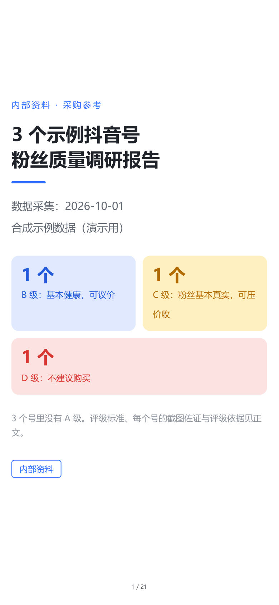
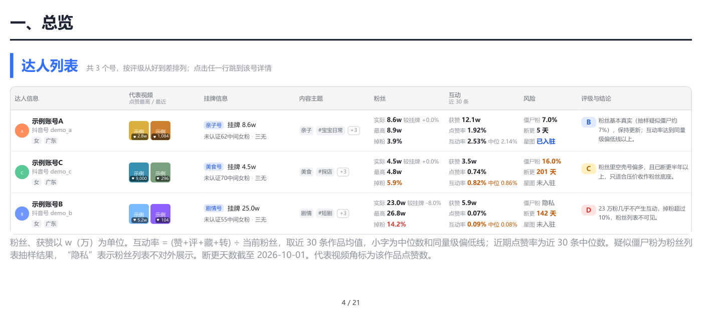
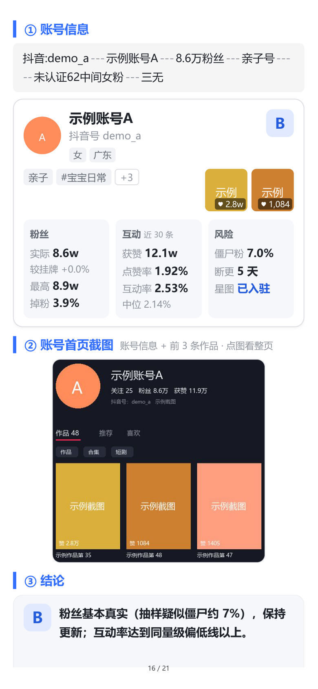
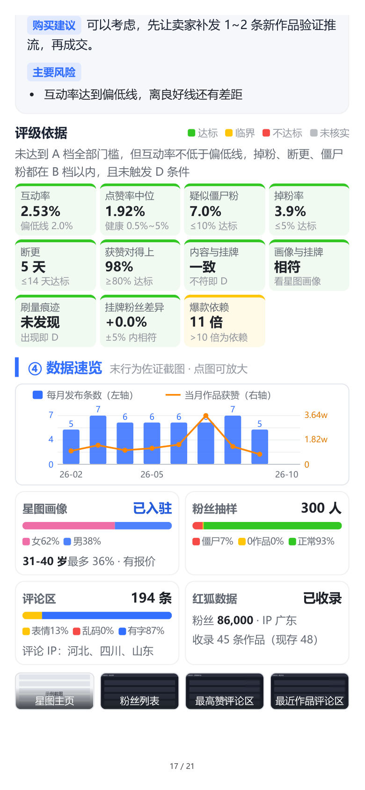
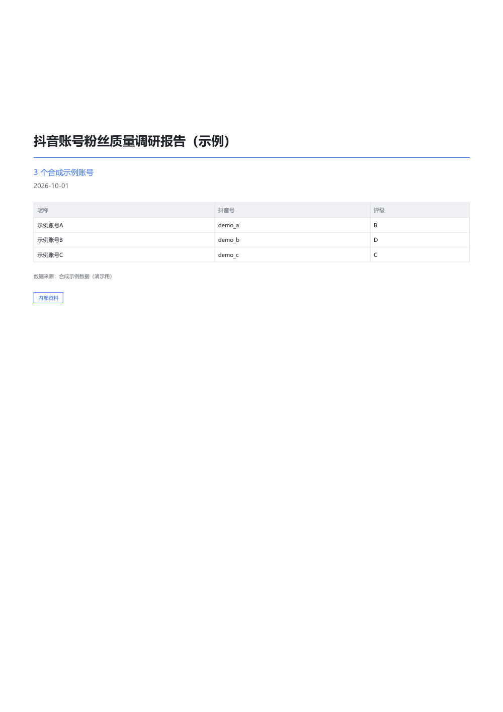
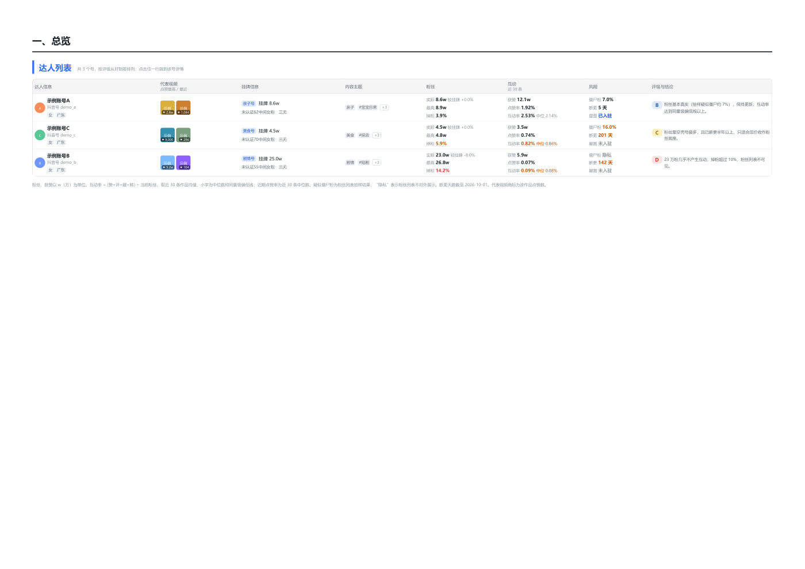
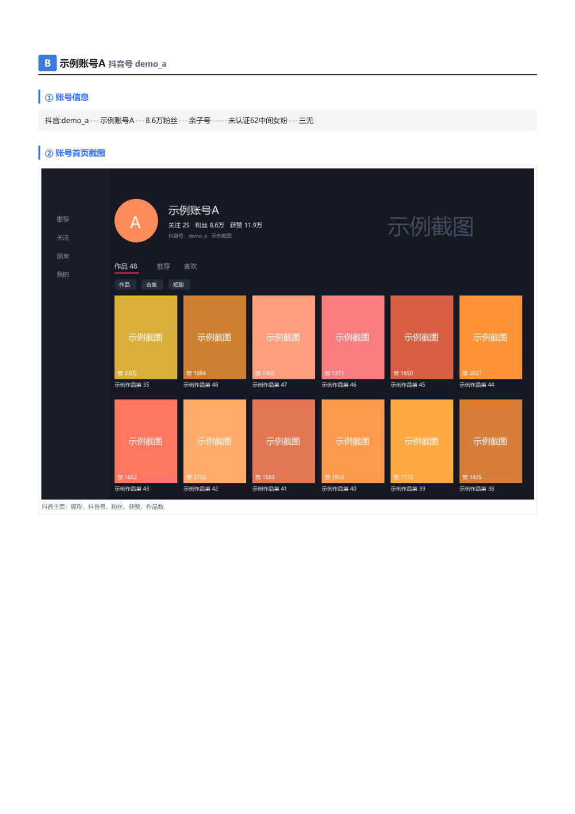
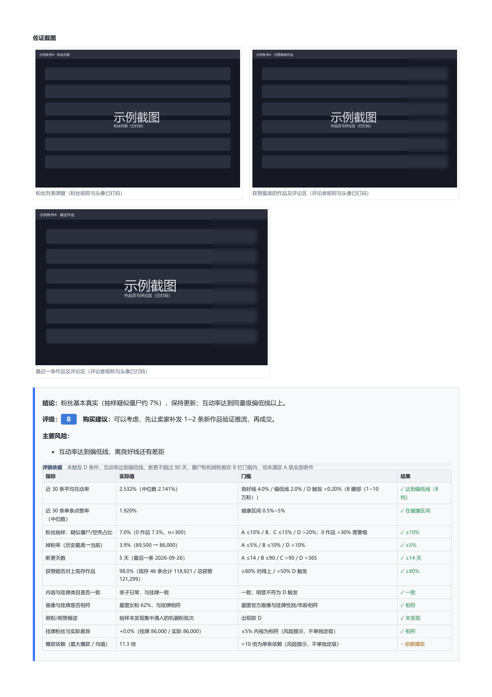

# 抖音账号粉丝质量调研（douyin-account-research）

收购抖音号之前，用来核实“粉丝是不是真的、互动是不是真的、画像和挂牌说的是否一致”的一套工作流和脚本。

- **输入**：卖家的挂牌截图，一行一个号，例如 `抖音:12345678901---4.6万粉丝---亲子号-----未认证60中间女粉---三无`。
- **过程**：
  1. 先按规则筛号；
  2. 再用已登录的浏览器**只读**采集抖音网页版和巨量星图的公开数据，并调用红狐数据接口；
  3. 每个号都做 8 项必做调研：主页数据、全部作品、评论区、粉丝抽样、截图证据、星图、红狐、总览素材。
- **输出**：
  - 逐号给出 A/B/C/D 评级和购买建议；
  - 交付 HTML 和 PDF 报告，评级规则和行业出处都写在报告里。

它是为“一个主 agent 加多个子 agent 并行采集”的场景写的：主 agent 读 [SKILL.md](SKILL.md) 和 [docs/](docs/) 里的流程，派子 agent 采集，再用一条命令出报告。人工按文档操作也可以。

## 两种报告模式

调研和采集的内容两种模式完全一样，只是呈现方式不同。下面的样张都来自合成示例批次（`examples/output/`），不含真实账号。

| | 简约模式（默认） | 复杂模式（完整版） |
|---|---|---|
| 交付 | 手机优先 `report.html` + 手机 PDF `report.pdf`（390×844） | 桌面版 `report-full.html` + A4 PDF `report-a4.pdf` |
| 总览 | 8 列横屏宽表，HTML 整体缩放到屏宽，PDF 单独排横屏页 | 同一张宽表，排在 A4 横向页上，另加总览图表 |
| 分账号详情 | 卡片式，每号不超过 2 页：账号卡片、主页截图（账号信息 + 前 3 条作品）、结论和评级依据、矮时间线和证据缩略图 | 每号从新一页开始：整张主页截图、星图大图、全部图表、红狐数据、佐证截图和评级依据表 |

简约模式（手机 PDF：首页、横屏总览、一个号的两页卡片）：

<p>




</p>

复杂模式（A4 PDF：封面、横向总览、账号详情首页、佐证截图与结论）：

<p>




</p>

手机 PDF 节选：[examples/output/simple-sample.pdf](examples/output/simple-sample.pdf)。

## 快速开始（用示例批次跑通两种模式）

```powershell
pip install -r requirements.txt
playwright install chromium          # 没有 Microsoft Edge 时需要
python scripts/tools/make_demo_batch.py
python scripts/build_report.py --config examples/demo-batch/batch.json --mode both --check
```

产物在 `examples/demo-batch/preview/`：`report.html`、`report.pdf`（简约），`report-full.html`、`report-a4.pdf`（复杂），`progress/` 下是版面自检图。示例批次是 3 个合成账号（预期评级 B、D、C），截图都是占位图，不需要浏览器和红狐密钥。

## 用于真实批次

1. 复制 `config/batch.example.json`，填批次名、工作目录、预览目录、报告模式、剔除词表等（真实配置放在仓库外，或放在 `config/` 下，不会被提交）。
2. 准备 ego-browser，打开并登录抖音网页版和巨量星图（代理不会替你登录）；把红狐密钥设成环境变量 `REDFOX_API_KEY`（方法见 [scripts/README.md](scripts/README.md)）。
3. 按 [docs/WORKFLOW.md](docs/WORKFLOW.md) 走：挂牌截图筛选 → 分组 → 采集（`scripts/collect/`）→ 合并和定性判断 → `python scripts/build_report.py --config <batch.json>`。

采集要有人值守：遇到验证码或登录失效，脚本会写暂停开关并停下，由人处理后再续跑。

## 目录结构

```text
README.md            本文件
SKILL.md             给 agent 的入口：启动顺序、硬规则、文档和脚本索引
docs/
  WORKFLOW.md        完整工作流：筛选、分工、采集、指标与评级、报告规范、踩坑与对策
  checklists.md      各阶段验收清单（含每号 8 项必做调研核对）
  prompts.md         子 agent 提示词模板和派发顺序表
  CROP_RULE.md       主页截图的裁剪规则和采集要求
scripts/
  build_report.py    一条命令生成报告（--mode simple|full|both，--check 做版面自检）
  config.py          批次配置读取
  collect/           浏览器采集（抖音、星图）、分组、裁剪验收、素材、红狐
  analyze/           合并、必做项核对、作品/粉丝/评论指标、评级规则
  report/            报告、图表、卡片详情、PDF、星图截图抹水印
  tools/             公开前检查、截图检查、PDF 缩略图、示例批次
  README.md          每个脚本的用途和完整命令顺序
config/batch.example.json   批次配置模板
examples/demo-batch/        合成示例批次（可直接运行）
examples/output/            两种模式的样张
requirements.txt
```

## 依赖

- Python 3.10+，`pip install -r requirements.txt`（Pillow、NumPy、PyMuPDF、Playwright）。
- Microsoft Edge：A4 PDF 用 Edge 无头打印，手机 PDF 和截图检查用 Playwright 的 Edge 通道；没有 Edge 时退回 Playwright 自带的 Chromium。
- 采集：ego-browser（面向 agent 的 Chromium 浏览器，采集脚本在它的 `ego-browser nodejs` 环境里运行），以及已登录抖音网页版和巨量星图的浏览器窗口。
- 红狐数据：[redfox-community](https://github.com/redfox-data/redfox-community) 的接口和积分。
- 中文字体：微软雅黑、黑体、苹方或 Noto Sans CJK 任一。

## 安全与合规

- **只读**：不关注、不点赞、不评论、不私信，不下单、不邀约、不收藏、不改设置；只调研清单里的号。
- **不替用户登录**：不替用户登录或注册任何平台，不扫码；不关闭、不登出用户的浏览器窗口，不清 cookie。
- **遇到验证码就停**：验证码、登录弹窗、风控提示一律不处理，写暂停开关后停下，由人处理。
- **密钥只放环境变量**：红狐密钥只从 `REDFOX_API_KEY` 读取，不写进任何文件、日志、报告或聊天；原始返回存档前会去掉密钥。
- **隐私**：截图里评论者和粉丝的昵称、头像打码；星图截图裁掉顶部登录名，并在本地抹掉平铺水印（不绕过平台的防篡改机制，带水印的原图只留工作目录）；报告里不出现人名。
- **数据不进仓库**：真实批次的配置、采集数据、截图和报告都在仓库外，不提交。提交前运行 `python scripts/tools/check_public.py`，检查密钥格式、个人路径、邮箱和本机拒绝名单里的词。

报告用于收购前的内部决策参考。采集和使用数据时请遵守各平台的用户协议和适用法律。

## 文档索引

| 文档 | 内容 |
|---|---|
| [SKILL.md](SKILL.md) | agent 入口：什么时候用、启动顺序、硬规则 |
| [docs/WORKFLOW.md](docs/WORKFLOW.md) | 完整工作流 |
| [docs/checklists.md](docs/checklists.md) | 验收清单 |
| [docs/prompts.md](docs/prompts.md) | 子 agent 提示词模板 |
| [docs/CROP_RULE.md](docs/CROP_RULE.md) | 主页截图裁剪规则 |
| [scripts/README.md](scripts/README.md) | 脚本说明和命令 |
| [config/batch.example.json](config/batch.example.json) | 批次配置模板 |
