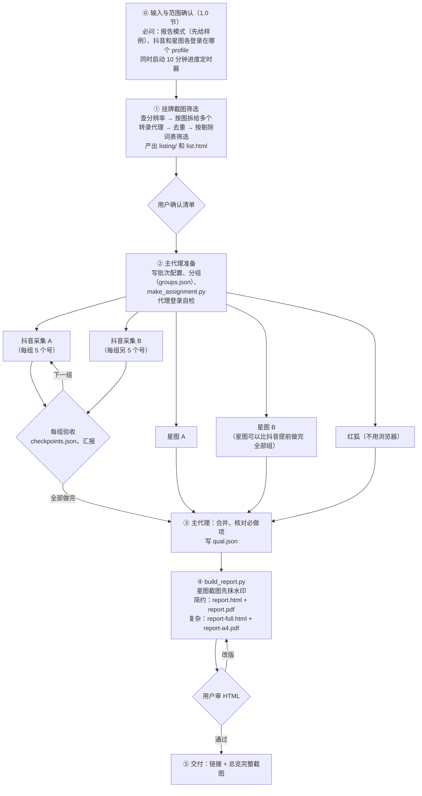

# 待购抖音号粉丝质量调研工作流

适用场景：用户发来卖家的挂牌截图，要从中筛出值得买的抖音号，逐个调研粉丝质量、真实互动和粉丝画像，给出 A/B/C/D 评级和购买建议，交付 HTML 和 PDF 报告。

本文整理自第一批（10 个号）和第二批（53 个号，分组连续调研）的实际做法。脚本都在仓库的 `scripts/` 下，按批次配置运行，不需要复制或改脚本；每个脚本的用途、输入输出和完整命令顺序见 `scripts/README.md`。

配套文件（同一目录）：

- `checklists.md`：验收清单，包括每个号的必做调研项核对表。
- `prompts.md`：可以直接贴给子代理的任务模板，以及派发顺序表。
- `CROP_RULE.md`：主页截图的裁剪规则和采集要求。

标“待确认”的内容没有验证清楚，不要当成事实写进报告；标“TODO”的内容还没有脚本实现，按文中的做法手工完成。

**命令约定**：所有 `python scripts/...` 命令都在仓库根目录 `<REPO>` 下运行。下文用 `$cfg` 指本批配置文件：先执行 `$cfg = '<BATCH_CONFIG>'`。

---

## 路径占位符

文中的本机路径一律写成占位符。

| 占位符 | 含义 | 示例 |
|---|---|---|
| `<批次名>` | 本批的名字 | `batch-001` |
| `<REPO>` | 本仓库根目录，所有 `python scripts/...` 命令在这里运行 | 克隆下来的目录 |
| `<WORK_ROOT>` | 所有批次工作目录的上级目录。开工时按 2.4 节实测，放在剩余空间多的盘 | 任意空间充足的目录 |
| `<WORK_DIR>` | 本批工作目录，放原始截图、JSON、生成的轮次脚本和中间文件 | `<WORK_ROOT>\<批次名>` |
| `<WORK_DIR_URL>` | 同上，正斜杠写法，用于 `file:///` | `<WORK_ROOT>/<批次名>` |
| `<BATCH_CONFIG>` | 本批配置文件（2.2 节） | `<WORK_DIR>\batch.json` |
| `<PREVIEW_ROOT>` | 预览服务的根目录（通过 http 对外提供） | 任意目录 |
| `<PREVIEW_DIR>` | 本批预览目录，只放压缩后的 JPEG、需要在浏览器里打开的 HTML 和最终 PDF | `<PREVIEW_ROOT>\<批次名>` |
| `<PREVIEW_URL>` | 本批预览网址前缀 | `http://127.0.0.1:8765/<批次名>` |
| `<EGO_SKILL>` | ego-browser 的 Skill 说明 | 随 ego-browser 安装 |
| `<REDFOX_SKILLS>` | 红狐社区技能文档 | https://github.com/redfox-data/redfox-community |
| `<DOCS_DIR>` | 本工作流文档所在目录 | `<REPO>\docs` |

两种报告模式的样张在仓库的 `examples/output/`（合成数据）：简约模式 `simple-p01.jpg`、`simple-p04.jpg`、`simple-p16.jpg`、`simple-p17.jpg` 和 `simple-sample.pdf`；复杂模式 `full-p01.jpg`、`full-p03.jpg`、`full-p06.jpg`、`full-p10.jpg`。

---

## 0. 一页总览



**硬规则**

1. 开工先做 1.0 节的输入确认（报告模式、profile 等），然后是挂牌截图筛选。用户确认清单后才开始采集。
2. 每个号的 8 项必做调研（第 3 节）一项都不能少。排版压缩只改呈现方式，不减调研内容。
3. 每个浏览器窗口固定分给一个子代理。同一个窗口、同一个标签页，同一时刻只能有一个代理在操作。用户的窗口不能关，不能登出，不能清 cookie，也不能去恢复或最小化。
4. 只读：不关注、不点赞、不评论、不私信，不下单、不邀约，不替用户过验证码、不替用户登录。密钥只放环境变量。
5. 子代理一律后台派发（`run_in_background: true`），一个输出路径只派一个代理。
6. **每 10 分钟汇报一次进度（硬性规定）**：主代理开工时就启动 10 分钟定时器（5.6 节），每次被唤醒都要向用户汇报，并附最新的预览截图链接，格式 `<PREVIEW_URL>/progress/<文件名>.jpg`。
7. **边做边写盘，断了就续做**：子代理每完成一个最小单位（一行转录、一个号的一步、一张截图）就立刻写盘或追加写入。网络中断导致子代理失败时，主代理先查产出文件，再用 resume 让同一个子代理从断点续做（5.5 节）。
8. **公开安全**：本工作流会公开发布。文档、脚本、提示词里不写密钥、人名和用户的登录信息；本机路径用占位符。
9. **开工先问报告模式**：简约模式（默认）还是复杂模式（1.0 节）。先给两种模式的样例再问；用户没回答就用简约模式。**模式只影响呈现方式，两种模式的调研采集项完全一样，一项都不能少。**
10. **profile 不靠推断**：抖音、星图各登录在哪个 profile，开工前用 AskQuestion 分别问用户；代理建好 space 后先做登录自检，不过就停（5.3 节）。
11. **星图截图要抹水印**：星图页面铺满登录账号名的水印。不绕过平台的防篡改；带水印的原图只留工作目录，预览图和报告图一律本地后处理抹掉（6.9 节）。

两种模式的区别（详细规范见第 8 节）：

| | 简约模式（默认） | 复杂模式（完整版） |
|---|---|---|
| 交付 | 手机优先 `report.html` + 手机 PDF `report.pdf`（390×844，封面、目录、页码） | 桌面版 `report-full.html` + A4 PDF `report-a4.pdf`（封面、目录、页码） |
| 总览 | 横屏宽表 8 列；HTML 缩放到屏宽；手机 PDF 用横屏页 | 同一张宽表，在 A4 横向页上；加总览图表和评判标准出处 |
| 分账号详情 | 卡片式，每号 ≤2 页：① 挂牌行和卡片 → ② 首页截图（按 `CROP_RULE.md` 裁成“账号信息 + 前 3 条作品”）→ ③ 结论和依据小块 → ④ 矮时间线、快览、证据缩略图 | 每号从新一页开始：① 账号信息 → ② 首页截图（整张视口截图，不裁剪）→ ③ 星图大图（不折叠）→ ④ 爬取数据、红狐数据和结论（全部图表和依据清单） |
| 命令 | `python scripts/build_report.py --config $cfg` | `python scripts/build_report.py --config $cfg --mode full` |

两种模式都先由 `scripts/report/build_full.py` 生成完整版，再由简约模式的脚本在它的基础上加工（6.13 节）。`--mode both` 两种都出，文件名不冲突。

**时间预估**：
- 筛选 15~30 分钟（取决于截图清晰度和行数）。
- 抖音采集：第二批实测每号十几分钟，作品上千条的号更久；两个抖音代理并行，每组 10 个号约 1 小时。第一组做完后按实际用时重新估算全部完成时间（4.3 节）。
- 星图每号约 1 分钟，不依赖抖音，可以提前做完全部组；红狐几分钟。
- 指标、报告、PDF 约 1 小时（`build_report.py` 本身几分钟）。

---

## 1. 开工：输入确认与挂牌截图筛选

### 1.0 输入与范围确认（开工必问）

主代理收到任务后、派任何子代理之前，先确认下面几项。可以一次问完；挂牌截图的转录不用等回答，可以同时开始。

1. **报告模式（必问）**：简约模式还是复杂模式。
   1. 先在正文里给出两种模式的样例链接，每个配一句说明（先给素材再提问）。样例用仓库 `examples/output/` 里的样张（见开头）。
   2. 再用 AskQuestion 提问，问题提示里也写上这几个链接。示例：
      - 问题：“这批报告用哪种模式？两种模式的调研内容完全一样，只是呈现方式不同。”
      - 选项 1：“简约模式（默认）：总览横屏宽表，每个号不超过 2 页手机 PDF；交付手机 HTML 和手机 PDF。样例 `<链接>`”
      - 选项 2：“复杂模式：桌面版 HTML 和 A4 PDF，每个号从新一页开始，星图大图和完整图表都展开。样例 `<链接>`”
   3. 用户没回答（或说“都行”）就用简约模式，并在下一次进度汇报里说明“按默认用了简约模式”。
   4. 结果写进批次配置的 `mode`（`simple` 或 `full`，2.2 节）。之后的脚本、子代理提示词都以它为准。
   5. **模式只决定第 6.13、6.14 节和第 8 节怎么做。第 3 节的 8 项必做调研两种模式完全一样，不能因为选了简约模式就少采。**
2. **profile（必问，不靠推断）**：用 AskQuestion **分别**问“抖音登录在哪个 profile”“星图登录在哪个 profile”。
   - 可以先跑只读盘点（5.3 节），把推断出的 profile 作为默认选项，但必须让用户确认。第二批盘点推断“全部窗口在同一个 profile”，实际抖音登录在另一个 profile，抖音代理在未登录状态下搜索，弹出登录框后写了暂停开关。
   - 同时问：两个抖音窗口是不是同一个抖音账号（决定节奏，6.2 节）。
3. **报告节奏**：号多时分组连续调研（4.3 节）。问用户要“全部做完出一份总报告”，还是“每组做完出一份”。第二批选的是前者。
4. 批次名，用来命名 `<WORK_DIR>`、`<PREVIEW_DIR>` 和 ego space。
5. 挂牌截图是不是原图；有没有本批不调研的范围（例如只看某几张图）。
6. 本批红狐积分上限。开工后先用一个号试查（6.10 节）。
7. 提醒用户：**代理的浏览器窗口不要最小化**。窗口最小化时 ego 拒绝截图，采集会卡住（6.1 节）。

### 1.1 输入

- 用户发来的卖家挂牌截图，一行一个号。常见格式：
  - `抖音:12345678901---4.6万粉丝---亲子号-----未认证60中间女粉---三无`
  - `抖音:12345678902---2.9万粉丝---萌宠-----未认证-58%女粉---三无`

  （文中的抖音号都是示例。）
- 字段依次是：抖音号、（有的有昵称）、挂牌粉丝、类型、认证状态和粉丝画像描述、状态（三无、状态正常等），有时带备注（如“收益 XXXX”）。`scripts/config.py` 的 `parse_line()` 按这个格式解析。
- 行上有删除线，表示已售。
- 截图上可能留有上一批任务的高亮或手绘圈，与本次筛选无关，不能因为有高亮就保留。

### 1.2 先查分辨率

1. 用 PIL 读每张图的尺寸，估算每行高度（表格区域高度 ÷ 行数，或用水平投影找文字行）。
2. **每行低于约 12 像素高时，抖音号很容易抄错**，要先请用户补发原图，或分段截清楚。第二批的 7 张图里，有 3 张长图每行只有 7~8 像素高。
3. 先做清晰的图，模糊的图尽力读，并把不确定的号标出来，不要等补图才开工。

### 1.3 切条、放大、转录

切条和 OCR 校验脚本还没收进仓库（TODO），按下面的做法写一个即可。

**按图拆给多个子代理并行。** 一个子代理读太多大图会卡死，网络一断就全部白做。做法：

- 每张长图（或每 100 行左右）派一个转录子代理，各写各的文件 `<WORK_DIR>\listing\rows_img<图号>.jsonl`。
- **逐条追加写入**：每读完一个横条，就把这一条里的行追加进自己的 `.jsonl`，并在 `<WORK_DIR>\listing\progress_img<图号>.json` 里记下已完成的条号。
- 中断后续做时，先读这两个文件，从下一个横条接着做，不重复已完成的条。
- 全部转录完，再由主代理或一个合并子代理统一去重、筛选，生成第 1.6 节的产出。

转录步骤：

1. 把每张图切成横条，每条 8~15 行，相邻两条重叠 12~30 像素，防止切到半行。
2. 横条放大 3~4 倍（LANCZOS），再锐化（UnsharpMask）、提高对比度 1.3 倍，保存为 `<WORK_DIR>\listing\strips\img<图号>_s<条号>_y<起>-<止>.png`，并写 `index.json`。
3. 逐条读图转录。本机如果有 OCR（例如 rapidocr_onnxruntime），拿来交叉校验，但不要花超过 5 分钟装环境。
4. 每行记录这些字段：
   - 来源图号、行序
   - 抖音号、粉丝数（万）、类型、认证状态
   - 粉丝画像原文、解析出的性别和女粉占比
   - 状态、是否删除线（已售）、是否“上新”、是否红字、备注
   - **置信度**：高、中、低。抖音号有任何一位拿不准就是“低”，不确定的位写成 `?`。
5. 置信度为“低”的行，把放大后的横条存成 JPEG 放到 `<PREVIEW_DIR>\uncertain\`，给用户对照。

### 1.4 去重

- 同一个抖音号只保留一条，记录它出现在哪几张图里。清晰图和模糊图重复时，以清晰图为准。
- 同一个号在两张图里写法不同时（粉丝数、画像不一样），两种都记下来，放进“待确认”。
- **与历史批次重复的号**标“已调研”，不进新队列。每批结束，主代理把该批 `listing\filtered.json` 里的号加进历史名单。历史名单由使用者自己在本机维护，不放进仓库。

### 1.5 筛选规则

**剔除词表写在批次配置里**（`listing_filter`，格式见 `config/batch.example.json` 和 2.2 节），按“类型包含某个词”匹配。用户会分几次补充要剔除的类型：

- 每次补充都追加进 `listing_filter.exclude_types`，然后**对全部挂牌行重新应用全部词**，不能只处理新补的词。第二批有一批补充是在合并代理运行时插话发过去的，结果漏掉了。
- 包含剔除词但用户想保留的组合写进 `exceptions`，例如“亲子种草”：先单列待确认，用户确认后按例外处理。
- 与已剔除类型近似的类型（例如已删“萌宠”，又出现“宠物”；已删“零食种草”，又出现“零食测评”）写进 `similar`，单列问用户，不自己决定。

按顺序判断，命中一条就不再往下看：

| 顺序 | 情况 | 处理 |
|---|---|---|
| 1 | 有删除线（已售） | 剔除 |
| 2 | 类型命中 `exceptions` | 单列，请用户确认（确认后按用户的决定处理） |
| 3 | 类型包含 `exclude_types` 里的任一词 | 剔除，原因写命中的词 |
| 4 | 男粉为主：“后排男粉”“N%男粉”都算 | 剔除 |
| 5 | 女粉低于 `min_female_pct`（默认 55%） | 剔除 |
| 6 | 类型命中 `similar` 或 `borderline`，以及说不清的类型 | 单列，请用户确认 |
| 7 | 画像缺失或看不清 | 单列，请用户确认 |
| 8 | 已在历史批次调研过 | 标“已调研”，不进队列 |
| 9 | 其余 | 保留 |

剔除词表的示例（第一批和第二批用户实际定下的）：颜值、美女、帅哥、搞笑、段子、剧情、短剧、解说、剪辑、种草、好物、木雕、手艺、萌宠、宠物、测评、蛋仔、文案、音乐、动漫、二次元、手工。“亲子种草”用户确认按亲子保留；“亲子剧情”单列待确认。

画像的读法：

- “60 中间女粉”“60中间女粉”：女粉 60%。
- “58%女粉”“-58%女粉”：女粉 58%。
- “81女粉”：女粉 81%。
- “后排男粉”“62%男粉”：男粉为主，剔除。

保留的号按类型分组（主力类型在前，例如亲子、育婴；边界和其他类型在后），组内按挂牌粉丝从高到低排序。分组见 4.3 节。

### 1.6 产出

| 文件 | 内容 |
|---|---|
| `<WORK_DIR>\listing\all_rows.csv` | 全部转录行，含筛选结论和原因。UTF-8 带 BOM，方便 Excel 打开 |
| `<WORK_DIR>\listing\filtered.json` | 本批待调研队列，批次配置的 `listing` 指向它。格式 `[{"id": "<抖音号>", "line": "<挂牌行>", ...}]`，另可带挂牌粉丝、类型、女粉占比、置信度、来源图、`type_group`。挂牌行统一成报告格式，例如 `抖音:12345678901---4.6万粉丝---亲子号-----未认证60中间女粉---三无` |
| `<WORK_DIR>\listing\filtered.csv` | 同上，给人看 |
| `<WORK_DIR>\listing\筛选清单.md` | 给用户看的文档：筛选标准（列出当前全部剔除词）；统计（转录行数、去重后账号数、保留数、各剔除原因数量）；保留列表；边界类型表；待确认表；剔除列表 |
| `<WORK_DIR>\listing\groups.json` | 分组（4.3 节） |
| `<PREVIEW_DIR>\list.html` | 同样内容的手机网页，飞书风格，不能横向滚动。置信度低的行附放大截图链接。地址 `<PREVIEW_URL>/list.html` |

后续所有脚本的号码列表都从 `filtered.json`（或 `groups.json`）来，不要手抄。

### 1.7 用户确认

1. 先在正文里发 `list.html` 和 `uncertain\` 里截图的链接，每个链接配一句说明，再请用户确认。先给素材，再提问。
2. 需要用户决定的：边界类型和近似类型留不留、看不清的号是否补图、置信度低的号码是否正确。
3. 用户确认后，把最终队列写回 `filtered.json`、重写 `groups.json`，再进入采集。

### 1.8 筛选踩过的坑

- 用户说“一共 11 个”，代理把一条被蓝线压住、本身没有高亮的行加了进去。其实用户是把一个同时出现在两张图里的号算了两次。教训：数量对不上时先查重复，不要为了凑数补号。
- 代理搜了“人民日报”等对照号，用户明确说只查清单里的号。
- 第二批用户分四次补充剔除类型，有一次的补充没有被重新应用，名单里还留着该剔除的号。教训：剔除词表落盘，每次都全量重算（1.5 节）。

---

## 2. 任务命名、批次配置、目录和磁盘

### 2.1 命名

批次名用用户给的名字。

- 工作目录：`<WORK_ROOT>\<批次名>\`。
- 预览目录：`<PREVIEW_ROOT>\<批次名>\`。
- 预览链接：`<PREVIEW_URL>/<文件名>`。
- ego 的 space 名：`<批次名>-dy-A`、`<批次名>-dy-B`、`<批次名>-xt-A`、`<批次名>-xt-B`（`make_assignment.py` 自动生成）。换 profile 时加后缀，例如 `<批次名>-dy-A-p2`（5.3 节）。

### 2.2 批次配置

所有脚本都用 `--config <BATCH_CONFIG>` 拿路径和账号清单，脚本里不写死本机路径、账号或密钥。以 `config/batch.example.json` 为模板，主代理开工时写到 `<BATCH_CONFIG>`（默认 `<WORK_DIR>\batch.json`，这时 `work_dir` 可以写 `"."`）。要点：

- `batch`：批次名；`work_dir`、`preview_dir`、`preview_url`：2.1 节的目录和网址（相对路径按配置文件所在目录解析）。
- `listing`：`listing/filtered.json`。
- `qual`：`qual.json`（6.12 节）。
- `mode`：`simple`（默认）或 `full`。
- `title`、`cover_*`、`date`、`analysis_time`、`collect_time`、`data_sources`、`short_names`：报告封面和正文用的文字。
- `redfox_budget`、`redfox_reserve`：红狐积分上限和预留。
- `listing_filter`：剔除词表（1.5 节），筛选代理读取，脚本不用。

环境变量优先于配置：`DY_WORK_DIR`、`DY_PREVIEW_DIR`、`DY_PREVIEW_URL`、`DY_REPORT_MODE`、`EDGE_PATH`。检查配置：`python scripts/config.py --config $cfg`。

### 2.3 工作目录结构

与 `scripts/README.md` 的“目录约定”一致：

```text
<WORK_DIR>\
  batch.json                   批次配置（2.2 节）
  listing\                     筛选产出：filtered.json、groups.json 等（第 1 节）
  qual.json                    定性判断（主代理写，6.12 节）
  locks\                       assignment.json、<代理>.json（心跳、done、oldSpaces）、PAUSE-douyin.flag、checkpoints.json
  accounts_<代理>.json         抖音号 → sec_uid；合并后为 accounts.json
  data_final\<id>\             profile.json、posts.json、comments2.json、fans_sample.json
  shots_clean\<id>\            01-profile.png、02-fans.png、03-top-<作品ID>.png、04-recent-<作品ID>.png、res.json
  assets_work\<id>\            总览素材原图（头像、两张封面、meta.json）
  xingtu_data\<id>.json        星图搜索与达人数据
  shots_mine\xingtu\<id>\      星图截图（抹水印后的版本，6.9 节）
  shots_mine\xingtu_raw\<id>\  带水印的星图原图（只留工作目录）
  redfox_data.json             红狐账号诊断与作品库；redfox_usage.json 调用记录；redfox_raw\ 原始返回（已去掉密钥）
  analysis_posts.json  fans_analysis.json  comments_analysis.json  coverage.csv
  parts\                       报告片段（总览表、图表、卡片详情、assets\、assets_manifest.json）
  dyA-NN.mjs  run-dyA-NN.cmd   make_run.py 生成的轮次脚本（每个代理各自的）
  logs\                        各代理日志与进度；crop-<代理>\ 裁剪验收的临时副本
<PREVIEW_DIR>\
  report.html  report.pdf              简约模式
  report-full.html  report-a4.pdf      复杂模式
  list.html                            筛选清单
  overview-assets\<id>\                总览头像与封面
  <id>\                                报告引用的截图（裁剪、打码、抹水印后的 JPEG）
  progress\                            进度截图、裁剪对照图、抹水印检查图、分段截图
  uncertain\                           低置信度转录行的放大图
```

### 2.4 磁盘

规则（不写死哪个盘）：

1. **开工时实测各盘剩余空间**：

   ```powershell
   Get-PSDrive -PSProvider FileSystem | Where-Object { $_.Used -ne $null } | Select-Object Name,@{n="FreeGB";e={[math]::Round($_.Free/1GB,2)}}
   ```

2. **大文件放在剩余空间多的盘**。大文件指原始截图、PDF 中间文件、JSON 和日志，也就是 `<WORK_DIR>`；据此选 `<WORK_ROOT>`。`<PREVIEW_DIR>` 跟着预览服务的根目录走，只放压缩后的 JPEG、要在浏览器里打开的 HTML 和最终交付物，占用很小。
3. **剩余低于 2 GB 的盘不写大文件**（建议值）。已开工的批次不搬目录：所在盘跌破 2 GB 时，先停下写大文件的步骤，告诉用户，由用户决定后续大文件放哪里。
4. **每次进度汇报顺带看一眼**各盘剩余空间（5.6 节），明显下降时在汇报里写出来。
5. 不要删除任何文件，也不要为腾空间清理别的目录。

一批大约占多少：第一批 10 个号共用了工作目录约 120 MB、预览目录约 36 MB；作品上千条的号会多一些。

---

## 3. 每个号的必做调研项（8 项，两种模式都一项不能少）

缺一项，这个号的报告就不完整。确实拿不到时，必须有证据（截图、接口返回码），并在报告里写明“不可见”“未收录”或“未入驻”。验收脚本：`python scripts/analyze/check_coverage.py --config $cfg`（`checklists.md` C 节）。

| # | 必做项 | 来源 | 产出文件 | 怎么算完成 |
|---|---|---|---|---|
| 1 | 主页基础数据：粉丝、历史最高粉丝、获赞、作品数、uid、认证、签名 | 抖音主页接口 | `data_final\<id>\profile.json` | 字段齐全，`found: true` |
| 2 | 全部作品列表（翻到 `has_more=0`），近 30 条互动率、点赞率、断更天数、爆款依赖、获赞能否对上现存作品 | 抖音作品接口；分析脚本 | `data_final\<id>\posts.json`；`analysis_posts.json` | 作品数接近主页作品数（95% 以上）；作品清空要有截图 |
| 3 | 评论区：5 条作品 × 2 页，评论类型和 IP 统计 | 抖音评论接口；分析脚本 | `data_final\<id>\comments2.json`；`comments_analysis.json` | 5 条作品都有结果，或注明作品不足 |
| 4 | 粉丝列表抽样：最近、爆款期、4 个探针，约 12 个粉丝主页；隐私要有截图 | 抖音粉丝接口；分析脚本 | `data_final\<id>\fans_sample.json`；`fans_analysis.json` | 有抽样页，或 `blocked: true` 加截图 |
| 5 | 截图证据（已打码）：主页、粉丝弹窗、最高赞作品评论区、最近作品评论区 | 抖音网页 | `shots_clean\<id>\` | 4 张都在，`res.json` 里每张 `ok: true`；主页截图通过裁剪验收（6.7 节） |
| 6 | 巨量星图：搜索结果截图；入驻的要基础信息、粉丝画像、传播和商业数据、主页截图（已抹水印） | 星图网页和接口 | `xingtu_data\<id>.json`；`shots_mine\xingtu\<id>\` | 找到时数据和截图齐全；未入驻时搜索截图能证明（含用昵称重搜一次） |
| 7 | 红狐账号诊断和作品库 | 红狐接口 | `redfox_data.json` 里该号的条目 | 有数据，或注明“未收录”（返回码 3203） |
| 8 | 总览素材：头像、两张作品封面、性别、地区、蓝 V | 抖音接口 | `<PREVIEW_DIR>\overview-assets\<id>\`；`parts\assets\<id>.json` | 3 张图都在；作品清空时用占位图 |

另外：账号创建时间（`analyze_posts.py` 用 uid 推算，写进 `uid_created_est`）、挂牌粉丝差异、内容与挂牌类目是否一致，由主代理在分析阶段算出并写进报告。

---

## 4. 总体流程与时间线

### 4.1 阶段

| 阶段 | 内容 | 谁做 | 依赖 |
|---|---|---|---|
| 0 | 输入确认（报告模式、profile、节奏）；启动 10 分钟定时器 | 主代理 | — |
| 1 | 挂牌截图筛选（按图拆给多个转录代理并行，再合并） | 转录代理 + 合并 | 截图 |
| 2 | 用户确认清单 | 用户 | 1 |
| 3 | 写批次配置；分组；盘点 profile；`make_assignment.py`；红狐试查一个号 | 主代理 | 2 |
| 4a | 抖音采集（按组） | 抖音 A、抖音 B | 3 |
| 4b | 星图（全部组） | 星图 A、星图 B | 3 |
| 4c | 红狐（全部号） | 红狐代理 | 3 |
| 5 | 每组验收、写检查点、汇报；派下一组 | 主代理 | 4a 的每一组 |
| 6 | 合并、核对必做项、写 `qual.json`、星图抹水印 | 主代理 | 4a 全部、4b、4c |
| 7 | `build_report.py`（含自检） | 主代理 | 6 |
| 8 | 用户审 HTML → 交付 | 用户、主代理 | 7 |

星图和红狐不依赖抖音结果，开工就可以做全部号；第二批星图比抖音提前好几组做完。抖音是瓶颈。

### 4.2 第一批的实际时间线（参考）

第一批（10 个号，单窗口）上午 11:42 开工，14:52 交付完整版报告，15:25 重新生成 A4 PDF，16:00 后做卡片详情样本和首页裁剪规则。耗时最多的是返工：幽灵代理覆盖数据、总览表出两版、合并脚本删内容（第 10 节）。

### 4.3 分组连续调研（号多时）

号多时（第二批 53 个），一次全派会让每个代理跑好几个小时，一断就很难查。改成分组连续做：

1. **分组**：每组 10 个号，写 `<WORK_DIR>\listing\groups.json`：

   ```json
   [{"name": "g1", "ids": ["..."], "A": ["..."], "B": ["..."]},
    {"name": "g2", "ids": ["..."], "A": ["..."], "B": ["..."]}]
   ```

   - `filtered.json` 先排好顺序：主力类型在前（例如亲子），边界类型在后，同类按挂牌粉丝从高到低。
   - `make_assignment.py` 按这个顺序单双号交替分给 A、B。第 k 组取 dy-A、dy-B 各自 `ids` 的第 5k+1~5k+5 个，正好是清单的第 10k+1~10k+10 个。这样分组和分配表一致，每个抖音代理每组 5 个号。
2. **派发**：`assignment.json` 里是整批的号，星图和红狐一次做完全部组；抖音代理每轮用 `make_run.py --ids <本组本代理的号>` 只做本组。裁剪对照图 `crop_check.py --agent` 只拼已有截图的号，它提示的“应有张数”是整批数，按本组号数核对。
3. **每组结束**：抖音代理汇报 → 主代理按 `checklists.md` D 节验收（含裁剪对照图）→ 写 `<WORK_DIR>\locks\checkpoints.json`（追加：组名、完成时间、每个号的必做项状态、问题）→ 向用户汇报这一组 → 用 resume 让**同一个**抖音代理继续下一组。锁文件里的 `done` 跨组累积，脚本自动跳过已完成的号。
4. **估时**：第一组做完后，按它的实际用时乘以剩余组数，重新估算全部完成时间，在汇报里写出来。
5. **报告节奏**：按 1.0 节用户的选择。“全部做完出一份总报告”时，各组只验收和汇报，不单独出报告；“每组出一份”时每组单独一个批次配置（`work_dir` 共用，`listing` 指向本组的清单）。
6. **两个抖音代理共用一个抖音账号时**：请求间隔不少于 5 秒，相邻两个号间隔不少于 30 秒，两个代理错开启动（例如 B 晚 1~2 分钟）。命令：`make_run.py ... --pace req=5000,account=30000`。

---

## 5. 任务拆分与浏览器分配

### 5.1 主代理做什么

- 开工第一件事：启动 10 分钟定时器（5.6 节），按 1.0 节问报告模式和 profile。只有主代理能和用户说话。
- 派筛选任务，发清单给用户确认，写剔除词表和分组。
- 写批次配置，盘点 profile，运行 `make_assignment.py`，红狐试查一个号。
- 派发子代理，盯日志，按 `checklists.md` 验收；每组写检查点并汇报。
- 合并（`merge_collect.py`）、核对必做项（`check_coverage.py`）、**亲手写每个号的 `qual.json`**、星图抹水印、运行 `build_report.py` 并看自检结果。
- 子代理失败时按 5.5 节检查产出、让同一个子代理续做。
- 换 profile、删暂停开关等改动由主代理做（5.3 节、6.2 节）。

### 5.2 四窗口方案

用户在 ego 里开了 4 个窗口：2 个抖音、2 个星图，都已登录，允许同时调用。

| 代理 | 固定使用 | 负责的号 | ego space 名 |
|---|---|---|---|
| 抖音采集 A | 抖音所在的 profile | 每组排序后的第 1、3、5…个 | `<批次名>-dy-A` |
| 抖音采集 B | 抖音所在的 profile | 每组第 2、4、6…个 | `<批次名>-dy-B` |
| 星图 A | 星图所在的 profile | 与抖音 A 相同 | `<批次名>-xt-A` |
| 星图 B | 星图所在的 profile | 与抖音 B 相同 | `<批次名>-xt-B` |
| 红狐 | 不用浏览器 | 全部 | — |

`make_assignment.py` 按排序后单双号交替分组，大号和小号在两组里分布均匀。

### 5.3 认领窗口、登录自检和换 profile

**先盘点（主代理，只读）。** 跑一个只有下面两行的脚本：

```js
console.log(JSON.stringify(await listTaskSpaces(), null, 1));
console.log(JSON.stringify(await profiles(), null, 1));
```

- `listTaskSpaces()` 返回空数组时，用户的窗口不是 ego 的 space，不能用 `claimTaskSpace` 认领（情况 B）。
- `profiles()` 返回本机所有 profile 的 `id`、`name`、`isDefault`。**登录在哪个 profile 从列表里看不出来**，推断结果只能当 AskQuestion 的默认选项（1.0 节）。

**写分配表**（主代理）：

```powershell
python scripts/collect/make_assignment.py --config $cfg --mode B --groups 2 --profile dy-A=<抖音 profile id> --profile dy-B=<抖音 profile id> --profile xt-A=<星图 profile id> --profile xt-B=<星图 profile id>
```

情况 A 用 `--mode A --space-id dy-A=<id> ...`。已有分配表时加 `--force` 才覆盖。生成的 `<WORK_DIR>\locks\assignment.json`：

```json
{"batch": "<批次名>", "mode": "B", "report_mode": "simple",
 "agents": {
   "dy-A": {"space": "<批次名>-dy-A", "space_id": null, "profile": "<profile id>", "ids": ["..."]},
   "dy-B": {"space": "<批次名>-dy-B", "space_id": null, "profile": "<profile id>", "ids": ["..."]},
   "xt-A": {"space": "<批次名>-xt-A", "space_id": null, "profile": "<profile id>", "ids": ["..."]},
   "xt-B": {"space": "<批次名>-xt-B", "space_id": null, "profile": "<profile id>", "ids": ["..."]}}}
```

两种情况由 `scripts/collect/common.mjs` 的 `enterSpace()` 统一处理：

- **情况 A：窗口出现在 `listTaskSpaces()` 里，`ownership` 为 `user`。** 第一轮 `claimTaskSpace(<id>)`，再 `task.newPage()`，在自己新开的标签页里工作，不在用户原来的标签页里导航。结束时关自己开的页，`task.handOff()` 交还用户。
- **情况 B：窗口不在 space 列表里。** 在同一个 profile 下新建自己的 space：`taskSpace("<批次名>-dy-A", { profileId })`。新 space 开一个新窗口，同一 profile 共享 cookie，所以已经是登录状态。
- 后续轮次从锁文件读 `spaceId` 复用同一个 space。子代理**不调用** `finish()`；全部验收后由主代理逐个进入代理 space，调用 `await task.finish({ keep: [] })`，这只关代理开的窗口，不影响用户的窗口和登录态。

**登录自检（代理建好 space 后第一件事，不过就停）：**

- 抖音：打开综合搜索页 `https://www.douyin.com/search/<本组第一个号>?type=general`，页面上没有“登录”按钮，也没有登录弹窗，并且搜索流有返回。做法见 `prompts.md` 第 2 节“登录自检”：先只跑 `resolve` 一步，再进自己的 space 截一张综合搜索页亲眼确认。解析结果大多“未找到”也可能是没登录。之后的主页、截图步骤（`dy_profile_posts.mjs`、`dy_shots.mjs`）发现登录弹窗或验证码会写暂停开关 `PAUSE-douyin.flag` 并停。
- 星图：打开达人广场 `https://www.xingtu.cn/ad/creator/market` 不跳转到登录页（URL 不含 `login`、`passport`），并且第一次搜索接口返回成功。`xt_collect.mjs` 的 `openMarket()` 遇到登录页会直接报错退出。
- 自检不过：在回复里写明现象，附截图链接（截图里的登录信息要打码或抹掉），等主代理处理。**未登录状态下采到的数据一律作废重采。**

**换 profile（自检不过、用户确认登录在另一个 profile 时，由主代理做）：**

1. 在 `assignment.json` 里改该代理的 `profile`，space 名加后缀（例如 `<批次名>-dy-A-p2`），避免复用旧 space。
2. 改该代理的锁文件 `locks\<代理>.json`：把旧的 `spaceId`、`page`、`space` 移进 `oldSpaces` 列表（带时间），`spaceId` 和 `page` 置为 `null`；**保留 `done`**。这样 `enterSpace()` 下一轮会在新 profile 下新建 space。
3. 暂停开关 `PAUSE-douyin.flag` 先把原文备份到 `logs\pause-<时间>.txt`，再删除。
4. 列出在未登录状态下处理过的号（看日志时间），从 `done` 里移出，或在下一轮用 `--force-ids` 重做。
5. resume 同一个代理，说明换了 profile、哪些号要重做。旧 space 不要 finish，留给收尾时统一处理。

**窗口不能最小化：** ego 对最小化的窗口拒绝截图（`Cannot capture screenshot while the window is minimized`），截图步骤会一直卡住。开工时提醒用户不要最小化代理的窗口。遇到这个错误时等待后重试；只能恢复**自己 space 的窗口**，绝不去动用户的窗口。重试仍失败就停下，请用户把窗口恢复。仓库脚本还没有自动等待重试（TODO）：现在截图失败的号会在进度日志里记“失败”，窗口恢复后用 `make_run.py --steps shots --force-ids <号>` 重拍。

**锁定约定（两种情况都要遵守）：**

- 每个代理开工时写 `<WORK_DIR>\locks\<代理名>.json`（代理名、space 名、spaceId、开始时间、心跳、`done`），每做完一个号更新一次（`common.mjs` 自动维护）。
- 开工前检查：别的代理的锁文件里没有出现自己的 space 名或 spaceId；有就停下汇报。
- ego 的 space 名唯一，`taskSpace(名)` 遇到同名会复用同一个 space。所以各代理的 space 名必须不同。
- 每个代理只操作自己 space 里自己的页面标签，不调用 `task.tabs()` 去 adopt 不认识的标签页。
- **不要清 cookie、缓存或存储**：ego 的清除操作会作用于整个 profile，等于把用户的窗口也登出了。
- 子代理不对任何 space 调用 `finish()`，包括自己的。第一批有代理这样做过，导致别人的 space 消失。

**风险判断：**

- 情况 B 在两批里都用过，可行。同一 profile 同时开两个代理 space 也可行。
- 两个抖音窗口是同一个抖音账号时，两个代理的请求会叠加在同一账号上，更容易触发风控（`verify_check`）。对策是放慢节奏（4.3 节第 6 条），并共用一个暂停开关（6.2 节）。
- 星图双开同一账号会不会限流，待确认。

### 5.4 每个代理写哪些文件

各代理的写入范围互不重叠。不在自己范围内的文件一律只读。仓库里的脚本对子代理只读；要改脚本由主代理在仓库副本上改。

| 代理 | 只能写这些 |
|---|---|
| 转录代理（每张图一个） | `<WORK_DIR>\listing\rows_img<图号>.jsonl`、`progress_img<图号>.json`；`<WORK_DIR>\listing\strips\img<图号>_*`；`<PREVIEW_DIR>\uncertain\img<图号>_*` |
| 筛选合并（主代理或一个合并代理） | `<WORK_DIR>\listing\all_rows.csv`、`filtered.csv`、`filtered.json`、`筛选清单.md`；`<PREVIEW_DIR>\list.html` |
| 主代理 | `<BATCH_CONFIG>`；`<WORK_DIR>\listing\groups.json`；`<WORK_DIR>\locks\assignment.json`、`checkpoints.json`、`PAUSE-douyin.flag`（删除前备份）、各锁文件的 profile 切换字段；`<WORK_DIR>\accounts.json`、`parts\assets_manifest.json`（合并）；`qual.json`；分析结果；`parts\` 下的报告片段；`shots_mine\xingtu\`（抹水印）和 `xingtu_raw\`；`<PREVIEW_DIR>` 下的报告、图片和自检图 |
| 抖音 A | `<WORK_DIR>\accounts_dy-A.json`；`data_final\<A 组的号>\`；`shots_clean\<A 组的号>\`；`assets_work\<A 组的号>\`；`dyA-*.mjs`、`run-dyA-*.cmd`；`logs\dy-A*`、`logs\crop-dy-A\`；`locks\dy-A.json`；`PAUSE-douyin.flag`（只在遇到验证码或登录弹窗时写）；`<PREVIEW_DIR>\overview-assets\<A 组的号>\`；`parts\assets\<A 组的号>.json`；`<PREVIEW_DIR>\progress\crop-check-dy-A.jpg`、`progress\dy-A-*.jpg` |
| 抖音 B | 同上，把 A 换成 B |
| 星图 A | `<WORK_DIR>\xingtu_data\<A 组的号>.json`；`shots_mine\xingtu\<A 组的号>\`；`xtA-*.mjs`、`run-xtA-*.cmd`；`logs\xt-A*`；`locks\xt-A.json`；`<PREVIEW_DIR>\progress\xt-A-*.jpg`（抹水印后的预览图） |
| 星图 B | 同上，把 A 换成 B |
| 红狐 | `<WORK_DIR>\redfox_data.json`、`redfox_raw\`、`redfox_usage.json`；`logs\redfox*` |

### 5.5 派发和回收规则

- 派发时一律 `run_in_background: true`。前台等待的调用，用户一发新消息就会被打断；第一批因此出现过同一任务跑两份。
- 重新派发前，先看该任务的日志和锁文件心跳是否还在更新，确认它确实停了。
- 子代理自己启动的后台 shell，会在它的回合结束时被终止。长时间运行的浏览器脚本用 `make_run.py` 生成的 `.cmd` 分离启动（6.1 节）。
- 子代理回复要包括：输出文件的绝对路径、每个号 8 项必做调研的状态、失败原因、预览截图链接。

**断点续传（网络中断会让所有子代理同时失败，第一批开工当天下午发生过一次）：**

1. 子代理边做边写盘：
   - 每做完一个最小单位就写：转录是一个横条，采集是一个号的一项，截图是一张图。
   - 日志、转录结果用追加写入（`.jsonl` 或逐行追加的 `.log`），不要攒到最后一次性写。
   - 锁文件 `<WORK_DIR>\locks\<代理名>.json` 里维护 `done` 清单和心跳时间（`run_agent.mjs` 自动维护）。
   - 每次开工（包括续做）先读自己的锁文件和产出，跳过已完成的部分。
2. 主代理收到子代理失败的通知后：
   1. 先看产出文件、进度日志和锁文件，记下完成了哪些、断在哪里。
   2. 用分离进程启动的浏览器脚本可能还在跑，先看它的日志是否还在更新，避免续做时重复跑。
   3. 用 Task 的 `resume`（填原子代理的 id）让**同一个子代理**续做，同样设 `run_in_background: true`。续做消息写明：“网络中断后续做。已完成：……；从……继续；先读 `<锁文件>` 和 `<产出文件>`。”
   4. resume 失败时，确认旧任务的心跳已超过 10 分钟没更新，再用原提示词加上同样的续做说明派一个新代理，输出路径不变。
3. 多个子代理同时失败时，逐个检查、逐个续做，不要全部重新派发。

### 5.6 10 分钟进度定时器（主代理）

用户的硬性规定：主代理每 10 分钟汇报一次进度，附最新的预览截图链接，格式 `<PREVIEW_URL>/progress/<文件名>.jpg`。

在 Cursor 本地会话里的做法：主代理开工时，用自己的 Shell 工具启动一个后台循环，每 600 秒输出一行哨兵文字，再用 `notify_on_output` 在出现哨兵时唤醒主代理。

- 命令（PowerShell）：

  ```powershell
  while ($true) { Start-Sleep -Seconds 600; Write-Output ("PROGRESS-TICK " + (Get-Date -Format "HH:mm")) }
  ```

- Shell 工具参数：`block_until_ms: 0`（立刻转后台）；`notify_on_output: { pattern: "PROGRESS-TICK", reason: "10 分钟进度汇报" }`。
- 只能由主代理启动。子代理启动的后台 shell 会在它的回合结束时被终止。
- 网络中断或会话重启后，先检查定时器还在不在，不在就重新启动。交付完成后停掉它。

每次被唤醒时：

1. 看各子代理的进度日志（`logs\<代理>-progress.log`）、锁文件心跳和 `coverage.csv`（`python scripts/analyze/check_coverage.py --config $cfg`）。
2. 做 1~2 张最新截图，缩小成 JPEG 放进 `<PREVIEW_DIR>\progress\`，文件名带时间，例如 `tick-1650-1.jpg`。按阶段选截图：
   - 筛选阶段：`list.html`（`python scripts/tools/mshot.py --config $cfg list.html tick-1650 390 body 1`，最后两个参数表示从页面顶部开始、只截 1 段）；
   - 采集阶段：最新的裁剪对照图或一张打码截图的缩小版（星图图要先抹水印）；
   - 报告阶段：`report.html` 或 PDF 的页面图。
3. 向用户汇报以下内容：
   - 做完了什么、正在做什么、预计还要多久（分组时按第一组的实际用时估算）；
   - 每个号 8 项必做调研的完成数；
   - 有没有卡住、需要用户做什么；
   - 各盘剩余空间（2.4 节的命令），明显下降或有盘低于 2 GB 时写出来；
   - 截图链接。

---

## 6. 各子任务操作步骤

采集脚本都在 `scripts/collect/`，由 `make_run.py` 按代理生成每一轮的 `.mjs` 和后台启动 `.cmd`，代理不需要手写脚本。下面 6.3~6.9 节写的是脚本内部的做法和要求，排查问题或改脚本时看。

### 6.1 浏览器基础（ego-browser）

- 开工前运行 `ego-browser skill`，把输出存成文件再读，例如 `ego-browser skill > "$env:TEMP\ego-browser-skill.md"`。指南说明见 `<EGO_SKILL>`。
- **生成一轮采集**（抖音代理、星图代理都这样做）：

  ```powershell
  python scripts/collect/make_run.py --config $cfg --agent dy-A --ids <本组本代理的号，逗号分隔> [--pace req=5000,account=30000]
  Start-Process -FilePath "<WORK_DIR>\run-dyA-NN.cmd" -WindowStyle Hidden
  ```

  - `--agent` 取 `dy-A`、`dy-B`、`xt-A`、`xt-B`；不写 `--ids` 时取 `assignment.json` 里该代理的全部号。
  - 抖音默认步骤 `resolve,posts,comments,fans,shots,assets`，可用 `--steps` 只跑其中几步；星图固定一步 `xingtu`（`xt_collect.mjs`）。
  - `--force-ids` 重抓指定的号（例如未登录时处理过的号）。
  - 产出：`<WORK_DIR>\dyA-NN.mjs`（轮次脚本，参数直接写在里面，因为 ego 脚本拿不到 shell 的环境变量）和 `run-dyA-NN.cmd`（输出追加到 `logs\dy-A-NN.log`）。
  - 进度：`logs\dy-A-progress.log` 每号一行；锁文件 `locks\dy-A.json`（心跳、`done`）。
  - 中断后再运行一次 `make_run.py` 生成下一轮，已完成的号和已有产出自动跳过。
- `.cmd` 用 `Start-Process ... -WindowStyle Hidden` 分离启动：子代理自己的后台 shell 会在它的回合结束时被终止，分离的进程不会。`Start-Process` 的参数里有空格时要加引号。
- 脚本内部约定（`scripts/collect/lib/common.mjs`、`run_agent.mjs`）：`page.goto` 失败不中断；滚动用 `page.evaluate` 改滚动容器的 `scrollTop`，不用鼠标滚轮；同一个 space 里同一时刻只操作一个页面；每号开始前检查暂停开关。
- **窗口最小化时 ego 拒绝截图**（5.3 节）：遇到 `window is minimized` 一类错误，等待后重试，只恢复自己 space 的窗口；还不行就停下，请用户恢复窗口。脚本还不会自动重试（TODO），失败的号用 `--steps shots --force-ids` 重拍。

### 6.2 抖音：节奏和暂停开关

- 默认节奏（`run_agent.mjs`）：相邻两次接口请求至少 3 秒，相邻两个号至少 20 秒，搜索 6 秒，失败重试间隔 15 秒。第一批单窗口每号 60~90 秒的采集节奏没有触发风控。
- 两个抖音代理共用同一个抖音账号时放慢到请求 5 秒、换号 30 秒，并错开启动（4.3 节第 6 条）。
- 共用暂停开关 `<WORK_DIR>\locks\PAUSE-douyin.flag`：
  - 任何一个代理遇到 `verify_check`、验证码或登录弹窗，脚本立刻写这个文件（时间和原因），然后停下；代理汇报主代理。
  - 每个代理在开始每个号之前都检查这个文件，存在就停。
  - 只有主代理在和用户确认后才能删除它；删除前把原文备份到 `logs\`（5.3 节）。
- 碰到验证码一律不处理，不替用户登录。

### 6.3 抖音：解析 sec_uid（`dy_resolve.mjs`）

1. 抓包钩子（`lib/hook.mjs`）：用 `Page.addScriptToEvaluateOnNewDocument` 注入 XHR/fetch 钩子。**钩子只活在当前脚本进程里，每一轮都要在 `goto` 之前重新注入**（脚本已处理）。
2. **不用 `type=user` 的用户搜索**，会触发 `verify_check`。用综合搜索 `https://www.douyin.com/search/<抖音号>?type=general`，抓 `general/search` 流，逐行按 JSON 解析，找带 `sec_uid` 的 `user_info` 或 `author` 对象，用 `unique_id`（不区分大小写）或 `short_id` 匹配。
3. 写 `<WORK_DIR>\accounts_<代理>.json`：`{id: {found, nickname, unique_id, short_id, uid, sec_uid, follower_count, total_favorited, aweme_count}}`。主代理之后用 `merge_collect.py` 合并成 `accounts.json`。
4. 每个号都要有 sec_uid。第一批有一个号没解析到，请求主页时返回“UserId不合法”，被误判成封号。缺的 sec_uid 可以从星图 `get_author_base_info`（加 `need_sec_uid=true`）、红狐 `listWorkByAccount` 的 `authorSecUid` 补，或请用户提供主页链接。

### 6.4 抖音：主页与作品（`dy_profile_posts.mjs`）

1. 打开 `https://www.douyin.com/user/<sec_uid>`。
2. **在页面里发同源 XHR**：抖音签名 SDK 会自动给页面内的 XHR 签名。**不要设置 `xhr.timeout`**，会和 SDK 冲突（第二批复制的旧钩子里还带着这一句，仓库版已去掉）。
   - 公共参数：`device_platform=webapp&aid=6383&channel=channel_pc_web&pc_client_type=1&version_code=170400&version_name=17.4.0&cookie_enabled=true&platform=PC`
   - 主页：`/aweme/v1/web/user/profile/other/?<公共参数>&publish_video_strategy_type=2&source=channel_pc_web&sec_user_id=<sec_uid>`
   - 作品：`/aweme/v1/web/aweme/post/?<公共参数>&sec_user_id=<sec_uid>&max_cursor=<游标>&count=18`，翻到 `has_more=0`。
3. **防串号**：核对抓包 URL 里的 `sec_user_id` 或 `user_id`，以及返回体里的昵称。
4. 主页要留的字段：`follower_count`、`max_follower_count`、`total_favorited`、`aweme_count`、`uid`、认证、签名。
5. 输出 `data_final\<id>\profile.json`、`posts.json`（仓库版统一用这两个文件名；旧的 `collect2.mjs` 输出路径和文件名不统一）。

### 6.5 抖音：评论区（`dy_comments.mjs`）

1. 每号选 5 条作品：最近 3 条有评论的，加点赞最高的 2 条。每条 2 页评论，接口 `/aweme/v1/web/comment/list/?<公共参数>&aweme_id=<作品ID>&cursor=<游标>&count=20&item_type=0`。
2. 输出 `data_final\<id>\comments2.json`：`{作品ID: {why, create_time, desc, stats, comments: [...]}}`。
3. 网页里也要真的点开评论区截图（6.7 节）。
4. `analyze_comments.py` 统计：纯表情、乱码、默认昵称、泛泛的夸奖、中老年风格昵称、宝妈和儿童相关文字、重复文案、同一人评论 3 条以上、作者回复或点赞、评论 IP 前 10。

### 6.6 抖音：粉丝列表抽样（`dy_fans.mjs`）

抽样计划由脚本自动算：

- 爆款日期：点赞最高那条作品的发布日期，从第二天开始取。
- 4 个探针日期：在“账号创建时间（uid 推算，推不出就用最早作品日期）”到今天之间平均取 4 个日期。

步骤：

1. 网页点开粉丝弹窗（`[data-e2e=user-info-fans]`），截图。显示“TA还没有粉丝”或接口返回 2096，就是隐私，记 `blocked: true`。
2. 接口：`/aweme/v1/web/user/follower/list/?<公共参数>&user_id=<uid>&sec_user_id=<sec_uid>&offset=0&min_time=0&max_time=<时间戳>&count=20&source_type=1&gps_access=0&address_book_access=0&is_top=1`。
3. 抽样：最近 6 页；爆款期 5 页；4 个探针各 1 页；另抽约 12 个粉丝主页，看性别、年龄、IP。列表到底时页数会少于计划，如实记录。
4. 每页记录 `min_time`、`max_time` 和人数，用来算涨粉速度。
5. **机器粉信号**：本应 20 人的页只返回很少人，同时关注时间集中在几分钟内。第一批有一个号在某天凌晨 2 分钟内出现过这种批次。
6. 输出 `data_final\<id>\fans_sample.json`：`{id, uid, own, pages, probes, followers, profiles, blocked, fetched_at}`。请求失败重试 2 次，间隔 15 秒。

### 6.7 抖音：截图证据和裁剪验收（`dy_shots.mjs`、`crop_check.py`）

1. 视口 1280×860。每号拍：
   - `01-profile.png`：主页，按下面第 2 步的要求拍。两种模式都用这张原图：简约模式裁成卡片详情的 ②，复杂模式整张放进 ②；
   - `02-fans.png`：粉丝弹窗；
   - `03-top-<作品ID>.png`：点赞最高作品，打开评论区；
   - `04-recent-<作品ID>.png`：最近一条作品，打开评论区。
2. **主页截图采集要求**（详见 `CROP_RULE.md` 第 4 节，`dy_shots.mjs` 已按此实现）：
   1. 视口 `Emulation.setDeviceMetricsOverride { width: 1280, height: 860, deviceScaleFactor: 1, mobile: false }`。CSS 视口宽度必须是 1280（设备像素比可以是 2）；左侧栏保持默认展开。
   2. 截图前 `window.scrollTo(0, 0)` 滚到顶部，头部和第一排都要完整出现在视口里。
   3. 打开主页后至少等 6 秒，再确认第一排卡片的图片都已加载完：`img.complete && img.naturalWidth > 0`。
   4. 关掉登录弹窗、粉丝列表弹窗和各类提示条；把鼠标移到页面空白处，例如 (60, 800)，避免卡片悬停放大。
   5. 截取视口范围，不用 `fullPage`，存无损 PNG：`shots_clean\<id>\01-profile.png`。
3. 截图前确认页面上有目标号昵称，作品页 URL 含目标作品 ID。确认不了就记 `ok: false`，不硬拍。
4. 打码：
   - 给 `[data-e2e="comment-item"]`、`[data-e2e="user-fans-container"]` 及其中的 `/user/` 链接加 `filter: blur(8px)`；
   - 右侧“相关推荐”区域（1280×860 下为 975,50,1280,860）在生成报告时由 `report_data.py` 统一模糊。
5. 输出 `shots_clean\<id>\` 和 `res.json`（`profileOk`、打码数量、每张 `ok`）。只有 `ok: true` 的图能进报告。
6. **裁剪验收**（两种模式都做，它同时检验主页截图的采集质量）：
   - 抖音代理做完本组自己的号后：`python scripts/collect/crop_check.py --config $cfg --agent dy-A`，对照图 `<PREVIEW_DIR>\progress\crop-check-dy-A.jpg`。脚本把自己的号的 PNG 复制到 `<WORK_DIR>\logs\crop-dy-A\src` 再裁，不写别人的目录。
   - 主代理合并后对全部号：`python scripts/collect/crop_check.py --config $cfg`，对照图 `progress\crop-check.jpg`（`build_report.py --check` 也会出一张）。

   打开对照图逐张确认：
   - 信息完整：头像、昵称、关注/粉丝/获赞、抖音号和标签行，“作品 N / 推荐 / 喜欢”标签栏和“作品/合集/短剧”筛选条都在；
   - 第一排 3 张卡片完整，带点赞数和标题行；
   - 右侧没有半张卡片；
   - 底部没有第二排。

   命令行逐号打印的警告也要看：
   - 报“找不到红色下划线”（没滚到顶，或被弹窗遮住）、“标题行可能不完整”、“卡片间距不符”（视口宽度不对）的号，按第 2 步的要求重拍（`make_run.py --steps shots --force-ids <号>`）；
   - “头部有文字跨过右边界”的号人工确认；
   - 0 作品号只裁到标签栏和筛选条，第一排不足 3 条的号右侧留空，都属正常（`CROP_RULE.md` 第 7 节）。

   检测失败的号不会出现在对照图里，要对着号码清单数一遍。

### 6.8 抖音：总览素材（`dy_assets.mjs`、`assets_finalize.py`）

1. 头像取主页接口的头像地址。`cover1` 是点赞最高作品的封面，`cover2` 是最近作品的封面（`video.cover.url_list`，图文作品取第一张图）。
2. `dy_assets.mjs` 下载原图到 `<WORK_DIR>\assets_work\<id>\`（`avatar.img`、`cover1.img`、`cover2.img`、`meta.json`）。
3. 抖音代理做完本组后：`python scripts/collect/assets_finalize.py --config $cfg --agent dy-A`，转成 `<PREVIEW_DIR>\overview-assets\<id>\avatar.jpg`、`cover1.jpg`、`cover2.jpg`，并写 `<WORK_DIR>\parts\assets\<id>.json`（性别、地区、是否蓝 V、两张封面的点赞数、`note`）。主代理用 `merge_collect.py` 合并成 `parts\assets_manifest.json`。
4. 作品清空的号用灰底占位图，`note` 写“作品已清空”。

### 6.9 巨量星图（`xt_collect.mjs`、`xt_dewatermark.py`）

1. 按 5.3 节进入自己的 space，打开 `https://www.xingtu.cn/ad/creator/market`，做登录自检。
2. 切到“昵称找人”，在昵称输入框里填**抖音号**，按回车，抓 `/gw/api/gsearch/search_for_author_square`。
3. **模糊匹配要核对**：第一批搜一个号，返回的是中间两位顺序不同的另一个号。只有 `unique_id` 等于抖音号，或 `core_user_id` 等于抖音 uid，才算找到。
4. **没入驻很常见**：第二批第一组 10 个号里有 9 个搜不到。搜不到时：
   - 用抖音或红狐拿到的**昵称**再搜一次，结果里用 `core_user_id` 对 uid 确认是不是本号。`xt_collect.mjs` 目前只按抖音号搜（TODO：加昵称重搜），现在由星图代理在自己的 space 里写一轮小脚本搜昵称，结果截图存 `shots_mine\xingtu\<id>\01-search-nick.png`，命中时把达人数据补进 `xingtu_data\<id>.json`；
   - 两次都搜不到，`01-search.png` 搜索结果截图就是证据，报告写“未入驻”。
5. 找到后在页面里发 XHR，参数都带 `o_author_id=<星图ID>&platform_source=1`：
   - 基础信息：`get_author_base_info`（加 `need_sec_uid=true`）
   - 粉丝画像：`get_author_fans_distribution`（`fans_type` 取 1、2、3，含义待确认）、`author_audience_distribution`、`author_touch_distribution`
   - 传播：`get_author_spread_info`（`range=2` 为近 30 天，`range=3` 为近 90 天）
   - 商业：`author_cp_info`、`get_author_side_base_info`、`get_author_commerce_spread_info`、`get_author_marketing_info`、`author_link_struct`
   - 粉丝趋势：`get_author_daily_fans`（实际只返回 30 天）
   - 其他：`author_rec_videos_v2`、`get_author_contract_base_info`
   - 报价：`batch_get_transition_price`
6. 截图：`01-search.png` 搜索结果；`02-home.png`、`03-home-full.png` 达人主页 `https://www.xingtu.cn/ad/creator/author-homepage/douyin-video/<星图ID>`；`04-tab-N.png` 各标签页。
7. **对比星图类目和挂牌类目**：星图达人的内容类目和挂牌类型不一致时（例如挂牌“亲子”、星图标的是“剧情搞笑”），写进 `qual.json` 的 `content`，并作为风险。
8. 输出 `xingtu_data\<id>.json`（含 `aid`、`found`、各接口原始返回）、`shots_mine\xingtu\<id>\`。
9. 五维指数已下线；主页只有“达人概览、创作能力、履约能力”三个标签，没有粉丝画像标签（是否所有达人都这样，待确认）。画像用接口数据。
10. 星图不依赖抖音结果，可以先于抖音做完全部组。

**登录名和水印（隐私）：**

- 星图页面顶部有登录账号名，报告阶段 `report_data.py` 统一裁掉顶部 92 像素。**只裁一次**：`xt_collect.mjs` 采集时保留原图；如果某批截图在采集时已经裁过（例如用自写脚本），抹水印时加 `--precropped`（下面），否则报告阶段会再裁掉 92 像素的内容。TODO：把裁剪高度做成批次配置项。
- 星图页面还铺满浅灰平铺水印，内容是登录账号名，裁顶部去不掉。**不绕过平台的防篡改机制**（不改页面脚本、不隐藏水印元素）；带水印的原图只留在工作目录，**预览图和报告图一律在本地抹掉水印**：
  - 整批（生成报告前，主代理做）：`python scripts/report/xt_dewatermark.py --config $cfg --check`。它把原图备份到 `shots_mine\xingtu_raw\<id>\`，把抹好的 PNG 写回 `shots_mine\xingtu\<id>\`，可以重复运行；`--check` 出放大检查图 `<PREVIEW_DIR>\progress\xt-dewm-check.jpg`。
  - 单张（星图代理发预览截图时）：`python scripts/report/xt_dewatermark.py <原图> <PREVIEW_DIR>\progress\xt-A-<名>.jpg`。
  - 做法：浅色、近中性灰的像素（RGB 最小值 ≥222、色差 ≤8）用 9×9 中值滤波的结果替换，其余像素不动。
  - 合格标准：放大检查图里认不出任何字。认得出就调大 `--median` 或调低 `--min-level` 后重跑。叠在彩色图片上的水印抹不掉，但很淡；1 像素宽的浅色边框会变淡，属正常。

**用户自己搜不到时**，原因通常是：默认是关键词搜索，没有切到“昵称找人”；开着“只看有报价”之类的筛选；用昵称搜，同名太多。

### 6.10 红狐数据（`redfox_batch.py`、`redfox_call.py`）

接口文档在 `<REDFOX_SKILLS>\douyin-account-diagnosis\SKILL.md`、`douyin-works-crawler\SKILL.md`。

1. 密钥只从环境变量 `REDFOX_API_KEY` 读取，**不写进任何脚本、文档、报告或预览目录**，也不在聊天里贴。
2. **开工先试查一个号**：`python scripts/collect/redfox_batch.py --config $cfg <一个号>`。第二批旧密钥对应的账户余额为 0，返回码 3201“积分不足”（返回里带余额），而用户在网页后台看到积分充足：两边不是同一个账户。试查不通就停下请用户核对密钥。
3. **换密钥**：请用户在可见的 PowerShell 窗口里用隐藏输入设成用户级环境变量（不在聊天里贴；命令见 `scripts/README.md`“环境”一节）。已经开着的终端不用重启：运行脚本前执行 `$env:REDFOX_API_KEY = [Environment]::GetEnvironmentVariable('REDFOX_API_KEY','User')`，把新值刷新进当前进程（`scripts/config.py` 的 `redfox_key()` 只读当前进程的环境变量）。用 `Start-Process` 启动带参数的命令时，含空格的参数要加引号。
4. 整批：`python scripts/collect/redfox_batch.py --config $cfg [--est-cost 1]`。已在 `redfox_data.json` 里的号自动跳过；积分预算 = 批次配置的 `redfox_budget` 减 `redfox_reserve`。
5. 接口（`POST https://redfox.hk<路径>`，请求头 `X-API-KEY` 和 `Content-Type: application/json`）：
   - `/story/api/dyUser/queryData`，`{"accountIds": [...], "source": "抖音账号诊断-workbuddy"}`，可批量。返回昵称、粉丝、获赞、作品数、IP、性别、年龄、省市、`crawlTime`、相似账号、近 7 天作品。
   - `/story/api/dy/data/listWorkByAccount`，`{"uniqueName": "<抖音号>", "pageNum": 1, "pageSize": 50, "source": "抖音作品爬取"}`。返回收录的历史作品总数 `total` 和 `authorSecUid`。
6. 返回码：2000 成功；3203 表示库里没有、不扣积分，记“未收录”，不反复重试；3201 积分不足。
7. 每次调用记 `redfox_usage.json`，原始返回（去掉密钥）存 `redfox_raw\`。
8. **费用只能估算**：红狐不返回余额，也不返回每次扣了多少。参考：批量 `queryData` 一次查 10 个号约 0.6 积分；53 个号全流程约 77 次调用。
9. **看 `crawlTime`**：数据可能很旧，第二批见过一年前甚至 2019 年的抓取时间。报告里写明抓取时间，旧数据只作参考。
10. 没有粉丝画像接口。积分额度每批向用户确认。

### 6.11 第三方数据平台

蝉妈妈、飞瓜、新榜、抖查查、灰豚都**需要用户登录后才能用**，代理不替用户注册或登录。没入驻星图的号想要画像，可以请用户先登录其中一个平台，或请卖家提供创作者中心的粉丝画像截图。这两条路都还没有验证过，待确认。

### 6.12 合并、核对和定性判断（主代理）

```powershell
python scripts/analyze/merge_collect.py --config $cfg     # accounts_*.json → accounts.json；parts\assets\*.json → parts\assets_manifest.json
python scripts/analyze/check_coverage.py --config $cfg    # 每号 8 项必做调研 → coverage.csv
```

1. `coverage.csv` 全部 ✓（或例外有证据）后，再生成报告。
2. **亲手写 `qual.json`**（批次配置的 `qual` 指定位置，默认 `<WORK_DIR>\qual.json`），格式见 `scripts/README.md`：
   - `accounts.<抖音号>`：
     - `content`、`content_ok`：内容与挂牌类目是否一致（含星图类目对比），`true`、`false` 或 `null`（未核实）。
     - `portrait`、`portrait_ok`：画像是否相符，只有星图官方画像才算核实。
     - `brush`：刷量痕迹的事实，没有填 `null`；填了直接判 D。
     - `risks`：风险清单，按重要性排序。卡片只显示前 2 条。
     - `summary`：一句话结论。
     - `evidence_note`（可选）：补在“获赞最高作品”截图说明后面。
   - `notes`（可选，批次专属文字，不写进脚本）：`headline`（封面和结论第一句）、`grade_notes`（覆盖某个等级的默认说明）、`xingtu`（星图入驻情况补充）、`verdict`（结论部分追加段落）、`third_party`（方法说明里的第三方平台情况）、`cross`（三方交叉核对结论）。
   - **简约模式的卡片对长度有要求**（8.4 节）。
   - 不写人名、接口名、状态码、字段名和弹窗原文，用业务语言。
3. 评级由 `scripts/analyze/rating.py` 的 `rate()` 自动算，不要手工改。
4. 星图截图抹水印（6.9 节）：`python scripts/report/xt_dewatermark.py --config $cfg --check`，看放大检查图。

### 6.13 报告生成

一条命令（先确认批次配置的 `mode`、`qual.json` 和抹水印都已完成；PDF 需要 Edge 或 Playwright Chromium）：

```powershell
python scripts/build_report.py --config $cfg --check                 # 按配置的 mode（默认简约）：report.html + report.pdf
python scripts/build_report.py --config $cfg --mode full --check     # 复杂模式：report-full.html + report-a4.pdf
python scripts/build_report.py --config $cfg --mode both --check     # 两种都出，文件名不冲突
```

选项：`--skip-analyze` 跳过三个分析脚本；`--no-pdf` 只出 HTML（用户审 HTML 时用）；`--check` 做版面自检（见下）。

`build_report.py` 依次运行下面的脚本，任何一步失败即停。单独重跑某一步时按同样顺序手动执行（每个脚本都加 `--config $cfg`）：

| 顺序 | 脚本 | 简约 | 复杂 | 作用 |
|---|---|---|---|---|
| 1 | `analyze/analyze_posts.py`、`analyze_fans.py`、`analyze_comments.py` | ✓ | ✓ | 指标：`analysis_posts.json`、`fans_analysis.json`、`comments_analysis.json` |
| 2 | `report/build_full.py --no-merge` | ✓ | ✓ | 第一遍：完整版骨架；截图转成 `<PREVIEW_DIR>\<id>\dc-*.jpg`、`xt-*.jpg`（最大宽 1100，JPEG 质量 78；星图裁顶部 92 像素；作品截图右侧推荐栏模糊） |
| 3 | `report/build_overview_table.py`、`build_charts.py`、`build_charts_m.py` | ✓ | ✓ | 总览 8 列宽表 `parts\overview_table.*`；桌面版图表 `parts\charts\`；手机版图表 `parts\charts_m\`（含 `acct_<id>_s.html` 矮时间线） |
| 4 | `report/build_full.py` | ✓ | ✓ | 第二遍：合并总览表和图表 → `report-full.html` |
| 5 | `report/build_pdf.py` | | ✓ | A4 PDF → `report-a4.pdf` |
| 6 | `report/mobile.py` | ✓ | | 从 `report-full.html` 重建手机优先版 `report.html`（总览宽表按设计宽度排版再整体缩放到屏宽） |
| 7 | `report/build_detail_m.py`、`merge_detail.py` | ✓ | | 卡片详情 `parts\detail_m\acct_<id>.html`，替换进 `report.html` |
| 8 | `report/build_pdf_m.py` | ✓ | | 手机 PDF → `report.pdf` |

`--check` 的自检产出（都在 `<PREVIEW_DIR>\progress\`）：

- 复杂模式：`pdf-a4-sheet` 缩略总览，列出填充不足 60% 的页。
- 简约模式：`crop-check.jpg` 裁剪对照图；逐号 `chk-<id>` 页数检查（每号 ≤2 页）；`m-NN.jpg` 手机宽度分段截图和横向溢出检查（必须 0 个溢出元素）；`pdfm-sheet` 缩略总览。

注意：

- 批次专属文字（结论第一句、等级说明、第三方平台说明、三方对比结论）写在 `qual.json` 的 `notes` 里，脚本里没有写死的批次文字。
- 每个号从新一页开始（`section.acct{break-before:page}`）；图片、图表不被分页切断（`break-inside:avoid`）。
- 改了 `qual.json` 或数据后重跑整条命令即可，`mobile.py` 和 `merge_detail.py` 每次都从 `report-full.html` 重建。

### 6.14 PDF

- `report/build_pdf.py`（A4，复杂模式）：Edge 命令行无头打印，找不到 Edge 时改用 Playwright Chromium；PyMuPDF 找页码，第二遍把页码填进目录（`--no-pages` 跳过）。封面（标题、账号和评级、日期、数据来源）和目录自动生成，展开所有 `<details>`。“一、总览”的标题和宽表一起排在 A4 横向页上（第一批标题下留大半页空白的问题已修）。
- `report/build_pdf_m.py`（手机比例 390×844，简约模式）：封面、可点击的带页码目录、页脚页码；总览宽表单独排横屏页（`@page wide`），整体缩放到页宽。
- 封面文字来自批次配置的 `title`、`cover_title`、`cover_subtitle`、`cover_sources`、`date`。
- 两个 PDF 文件名不同（`report-a4.pdf`、`report.pdf`），不会互相覆盖。
- Edge 路径可用批次配置的 `edge` 或环境变量 `EDGE_PATH` 指定。

---

## 7. 指标与评级标准

以下数值与 `scripts/analyze/rating.py` 的 `TIERS`、`rate()`、`STD_ROWS`，以及 `analyze_posts.py`、`analyze_fans.py` 一致。改阈值要同时改脚本和报告的“评级标准”一节。

### 7.1 指标口径

| 指标 | 计算方法 |
|---|---|
| 近 30 条平均互动率 | (赞 + 评 + 藏 + 转) ÷ 当前粉丝，最近 30 条非置顶作品的均值，同时给中位数 |
| 单条点赞率 | 点赞 ÷ 粉丝，最近 30 条的中位数 |
| 疑似僵尸/空壳粉占比 | 粉丝抽样中，0 作品且粉丝 ≤5，并满足以下任一条：默认头像、默认昵称、点赞记录 ≤10 |
| 低活跃粉 | 不是僵尸，但 0 作品且点赞 <100 |
| 疑似营销或互粉 | 昵称或签名命中营销关键词，或关注 ≥5000 |
| 掉粉率 | (历史最高粉丝 − 当前粉丝) ÷ 历史最高 |
| 断更天数 | 距最后一条作品的天数，截至采集日 |
| 获赞能否对上现存作品 | 已抓作品获赞合计 ÷ 总获赞；抓到作品数 95% 以上才判定 |
| 爆款依赖 | 最大爆款获赞 ÷ 近 30 条均值 |
| 挂牌粉丝差异 | (实际 − 挂牌) ÷ 挂牌 |
| 账号创建时间 | `uid > 10**17` 时，`uid >> 32` 作为 Unix 时间戳推算（`uid_created_est`） |

默认头像：头像地址里含 `mosaic-legacy_379`。默认昵称：匹配正则 `^(用户\d{6,}|user\d+|\d{8,})$`。

### 7.2 互动率分层基准（红狐）

| 粉丝量级 | 优秀 | 良好（A 门槛） | 偏低线（B 门槛） | 偏低线的 10%（D 触发，本工作流自定） |
|---|---|---|---|---|
| S 头部（≥100 万粉） | 2.0% | 1.2% | 0.6% | 0.06% |
| A 头部（10~100 万粉） | 4.0% | 2.5% | 1.2% | 0.12% |
| B 腰部（1~10 万粉） | 6.0% | 4.0% | 2.0% | 0.20% |
| C 尾部（<1 万粉） | 8.0% | 5.0% | 2.5% | 0.25% |

红狐原规则还有两条预警：粉丝超过 5 万且互动率低于偏低线，提示僵尸粉风险；断更超过 14 天预警。

### 7.3 逐项门槛

| 指标 | A | B | C | D 触发 | 出处 |
|---|---|---|---|---|---|
| 近 30 条平均互动率 | ≥良好线 | ≥偏低线 | <偏低线 | <偏低线的 10% | 红狐分层基准；D 线自定 |
| 单条点赞率（中位） | ≥0.5% | 参考 | 参考 | — | 蝉妈妈：健康点赞率 0.5%~5% |
| 疑似僵尸/空壳粉 | ≤10% | ≤15% | ≤15% | >20% | 方法参考“抽查粉丝 0 作品比例 >30% 需警惕”；分档自定 |
| 掉粉率 | ≤5% | ≤10% | — | >10% | 自定 |
| 断更天数 | ≤14 天 | ≤90 天 | >90 天 | >365 天 | 红狐“断更 >14 天预警”；90、365 天自定 |
| 获赞能否对上现存作品 | ≥80% | ≥50% | ≥50% | <50% 或作品清空 | 自定 |
| 内容与挂牌类目一致 | 一致 | 一致 | 一致 | 明显不符 | 自定 |
| 画像与挂牌相符 | 相符 | 参考 | 参考 | — | 星图口径；判定自定 |
| 刷粉或刷赞痕迹 | 无 | 无 | 无 | 出现即 D | 自定 |
| 爆款依赖 | 风险提示 | 风险提示 | 风险提示 | — | 红狐：>10 倍为单条依赖 |
| 挂牌粉丝差异 | 风险提示 | 风险提示 | 风险提示 | — | 自定：±5% 内视为相符 |

刷量痕迹：粉丝按关注时间翻页，出现分钟级集中涌入且被平台过滤（每页明显少于 20 人）；或者点赞与评论严重失衡（第一批有一条作品 6.1 万赞只有 59 条评论）。

### 7.4 定级规则（`rate()`）

**D 触发条件**（每条计一项）：

- 互动率低于偏低线的 10%；
- 僵尸粉 >20%；
- 掉粉 >10%；
- 断更 >365 天；
- 作品清空；
- 获赞对不上现存作品（<50%）；
- 内容或主体与挂牌不符；
- 有刷粉或刷赞痕迹。

**定级：**

1. **D**：有刷量痕迹，或触发 2 项及以上 D 条件。
2. **C**：互动率低于偏低线，或断更 >90 天（或无作品），或僵尸粉 >15%，或掉粉 >10%。
3. **A**：同时满足以下全部条件：互动率 ≥ 良好线；点赞率中位 ≥0.5%；僵尸粉 ≤10%（必须能抽样）；掉粉 ≤5%；断更 ≤14 天；获赞对得上 ≥80%；内容与挂牌一致；画像与挂牌相符。
4. **B**：其余情况。
5. **—**：查不到账号，暂不评估。

**购买建议**（原文）：

- A：可以购买，按挂牌价议价。
- B：可以考虑，先让卖家补发 1~2 条新作品验证推流，再成交。
- C：不建议按挂牌价购买；如只需要粉丝底座，可大幅压价，并要求先补发作品验证推流。
- D：不建议购买。
- —：暂不评估；先让卖家提供主页链接或后台截图（含抖音号、粉丝数、作品列表）再核实。

第一批结果：5 个 C、5 个 D，没有 A 和 B。

### 7.5 行业出处

| 用途 | 链接 |
|---|---|
| 红狐账号诊断（分层基准、断更预警、爆款依赖） | https://github.com/redfox-data/redfox-community/blob/main/skills/douyin-account-diagnosis/SKILL.md |
| 蝉妈妈：健康点赞率 0.5%~5% | https://ai.chanmama.com/article/416 |
| 僵尸粉抽查方法 | https://news.huochengrm.cn/qzgl/40714.html |
| 星图指数口径 | https://www.shuaishou.com/ask/47649.html |
| 新榜帮助文档 | https://xd.newrank.cn/help/p/E48B9256DC20862B111DC72A06D0417F |
| 账号估值（粉丝稳定性） | https://www.zhanghaobang.cn/account/trade-risk/account-valuation |

出处截图放 `<PREVIEW_DIR>\standards\`，例如 `std-redfox-tiers.jpg`、`std-chanmama-likerate.jpg`、`std-xingtu-index.jpg`。

---

## 8. 报告格式规范

报告有两种模式，开工时由用户选（1.0 节），记在批次配置的 `mode`。8.1 节和 8.5~8.6 节两种模式都适用；8.3~8.4 节是简约模式；8.8 节是复杂模式；8.7 节分模式列交付物。**两种模式的调研内容和数据完全一样，只是排版不同。**

### 8.1 总原则

- **简约模式（默认）**：手机优先，资料主要在手机上看。HTML 在 390 像素宽下不能有横向滚动条；PDF 用手机比例（390×844）。以总览为主，分账号详情用卡片版式，**每个号不超过 2 页手机 PDF**。
- **复杂模式**：桌面版 HTML 和 A4 PDF，每个号的全部图表、截图和依据清单都展开，见 8.8 节。
- 两种模式共用：同一张总览宽表（8.2 节）；同样的评级标准、方法与数据源、三方对比章节；同一套评级结果。
- 风格简约，参考飞书：
  - 主色 `#3370FF`，正文 `#1F2329`，次要文字 `#646A73`、`#8F959E`，边框 `#DEE0E3`。
  - 评级色：A `#D9F5D6`/`#237B19`，B `#E1EAFF`/`#245BDB`，C `#FFF0C2`/`#B26A00`，D `#FDE2E2`/`#D83931`。
- 先交 HTML 给用户审（`build_report.py --no-pdf`），审过再出 PDF。用户明确要求同时给的除外。

章节：

1. 一、总览
2. 二、评级标准（第 7 节的门槛表和分层表，附出处）
3. 三、方法与数据源
4. 四、三方数据交叉对比（抖音、红狐、星图的粉丝数、地区、挂牌性别与画像）
5. 五、分账号详情

### 8.2 总览：横屏宽表（不要改成卡片；两种模式共用）

参照星图达人列表的样式。共 8 列：

1. 头像和昵称：头像、昵称、抖音号、性别、地区、蓝 V
2. 作品缩略图：点赞最高一条和最近一条的方块封面，带点赞角标
3. 挂牌信息
4. 内容主题
5. 粉丝数据：以 w（万）为单位，带历史最高和掉粉
6. 互动数据：近 30 条均值，小字给中位数和偏低线
7. 风险数据
8. 等级和结论

后面加三张总览图表：粉丝量与近期点赞率散点图、掉粉对比、各评级指标达标情况热力表。

生成：`scripts/report/build_overview_table.py` → `parts\overview_table.html`、`overview_table.css`（选择器都带 `.ovt-` 前缀；固定布局按百分比分列）。

显示要求：

- **HTML（简约模式）**：宽表按 1200px 设计宽度排版，再整体缩放到屏幕宽度，不出现横向滚动条（`mobile.py` 已实现）。
- **手机 PDF（简约模式）**：总览单独排横屏页（`build_pdf_m.py` 的 `@page wide`）。
- **A4 PDF（复杂模式）**：“一、总览”标题和宽表一起排在 A4 横向页上（`build_pdf.py`）。

### 8.3 分账号详情：卡片版式（简约模式）

用户原话：“你现在做的类似这种的总览，就可以在分账号详情作为呈现方式了”。卡片样本 2 页，同一个号原来的完整版要 13 页。样张见仓库 `examples/output/simple-p16.jpg`、`simple-p17.jpg`。

生成：`scripts/report/build_detail_m.py --config $cfg [抖音号 ...]` → `parts\detail_m\acct_<id>.html` 和 `detail.css`，再由 `merge_detail.py` 替换进 `report.html`（`build_report.py` 自动做）。它用到总览表里每号的那一行、`parts\charts_m\acct_<id>_s.html` 矮时间线（高 140）、`<PREVIEW_DIR>\<id>\` 下的截图。

每个号只保留四块：

1. **① 账号信息**：
   - 挂牌行，插入实际昵称，保留“未认证”等原文。
   - 下面一张卡片，复用总览表同一行的单元格：头像、昵称、抖音号、性别标签；等级在右上角；主题标签和两张作品缩略图；“粉丝、互动（近 30 条）、风险”三个数据框。
2. **② 首页截图**：按同目录 `CROP_RULE.md` 的最终规则（第 1~3 节）：
   - 固定裁“账号信息 + 第一排前 3 条作品”（`SHOT_MODE = "3"`），HTML 和手机 PDF 用同一张图。
   - 以“作品 N”标签下的红色下划线为锚点自动检测边界，不用死坐标。
   - 显示：手机 PDF 里宽 260px、居中（`SHOT_PDF_W = 260`，不要超过 260，否则结论头会被挤到下一页）；HTML 里最宽 400px、居中。导出 JPEG 质量 80，像素宽 520。
   - 输出 `<PREVIEW_DIR>\<id>\dc-01-home.jpg`。小标题后加灰色小字“账号信息 + 前 3 条作品 · 点图看整页”，点图打开整页截图 `dc-01-profile.jpg`。
   - 来源用 1280 宽的无损原图 `shots_clean\<id>\01-profile.png`（采集要求见 6.7 节第 2 步）。
   - 6 条模式（`--mode 6`）只给显示宽度 ≥720px 的宽版式备用，简约模式不用。
   - 例外（0 作品、无标题行、长认证说明、第一排不足 3 条）见 `CROP_RULE.md` 第 7 节。超过 2 页时按 8.4 节压缩其他块，截图本身不再裁短。
   - 验收：6.7 节第 6 步的对照图。
3. **③ 结论**：
   - 等级、一句话摘要、购买建议、**最多 2 条主要风险**。
   - 评级依据：一句话说明为什么是这个等级，下面是彩色小块，每行 4 个，共 11 个指标。每块写指标名、实际值、门槛。绿色达标、黄色临界、红色不达标、灰色未核实。
4. **④ 压缩可视化**：
   - 矮时间线图（高 140）：按月发布条数和当月作品获赞，灰色表示断更。
   - 2×2 快览小块：
     - 星图画像：男女比例条、最多的年龄段、有无报价；没入驻写“未入驻”。
     - 粉丝抽样：僵尸、0 作品、正常的比例条；隐私写“隐私”。
     - 评论区：表情、乱码、有字的比例条，评论 IP 前 3。
     - 红狐数据：粉丝、IP、作品库收录数；未收录写“未收录”。
   - 4 张证据缩略图，说明文字叠在图片底部，点图看大图。按顺序取前 4 张有的：星图主页（没入驻时用星图搜索结果）、粉丝列表、最高赞评论区、最近作品评论区、主页全图。

### 8.4 每号页数检查（简约模式）

1. `build_report.py --check` 会逐号跑 `sample_detail.py`；单号重查：`python scripts/report/sample_detail.py --config $cfg <抖音号> chk-<抖音号>`。
   - 生成 `<PREVIEW_DIR>\chk-<抖音号>.pdf` 和每页预览 `<PREVIEW_DIR>\progress\chk-<抖音号>-p<N>.jpg`，末尾打印 `pages N`。
2. **每号都要 `pages` ≤2**。
3. 整份 PDF 用 `pdfm-sheet` 缩略图看低填充页，用 `build_pdf_m.py` 打印的 `toc` 核对每号起止页。
4. 超过 2 页时逐号改 `qual.json`，按这个顺序：
   1. 截短 `summary`，建议不超过 70 个字；
   2. 风险只留 2 条，每条建议不超过 45 个字；
   3. 缩短评级依据那句说明；
   4. 缩小时间线高度，或压扁证据缩略图（改 `build_detail_m.py` 的样式）。

   字数上限都是建议值。**不要删掉任何一块，也不要删调研内容。**

### 8.5 不能出现的内容

- “抖音禁止转让售卖账号”之类的话（内部文件）。
- “未能验证的数据与原因”这一节。
- 状态码、接口名、字段名之类的技术括号。
- 人名，包括语音输入把普通词误识别成的人名（第一批出现过把“账号的”识别成人名的情况）。
- 未打码的评论者或粉丝昵称、头像；星图登录账号名，包括星图页面的平铺水印。
- 任何密钥。

### 8.6 单位和写法

- 粉丝、获赞用 w（万），例如 4.4w。
- 日期写“截至 YYYY-MM-DD”。
- 拿不到的数据写“未收录”“不可见”“未入驻”，不写原因代码。

### 8.7 交付物

简约模式：

- `<PREVIEW_DIR>\report.html`：手机优先 HTML，总览宽表缩放到屏宽，分账号详情是卡片。
- `<PREVIEW_DIR>\report.pdf`：手机 PDF（390×844），封面、可点击的带页码目录、页脚页码，总览横屏页，每号不超过 2 页。

复杂模式：

- `<PREVIEW_DIR>\report-full.html`：桌面版 HTML。
- `<PREVIEW_DIR>\report-a4.pdf`：A4 PDF，封面、可点击的带页码目录，总览 A4 横向页，每号从新一页开始。

两种模式都有：

- `<PREVIEW_DIR>\progress\overview-full.jpg`：总览完整截图，给用户转交对接方（`python scripts/tools/snap_overview.py --config $cfg`）。
- `<PREVIEW_DIR>\list.html`：本批筛选清单。

### 8.8 复杂模式（完整版）

对应第一批交付的完整版：桌面版 HTML 加约 50 页 A4 PDF。样张见仓库 `examples/output/full-p01.jpg`、`full-p03.jpg`、`full-p06.jpg`、`full-p10.jpg`。生成见 6.13 节，PDF 见 6.14 节。

**整体结构**（`build_full.py` 生成，`build_pdf.py` 加封面和目录）：

1. 第 1 页封面：标题、账号和评级列表、日期、数据来源、“内部资料”标签。
2. 第 2 页目录：可点击跳转、带页码。
3. 一、总览：星图风格宽表（8.2 节），排在 A4 横向页；后面是总览图表：散点图、掉粉对比、达标热力表。
4. 二、评级标准：门槛表和分层表，附出处链接（第 7 节）。
5. 三、方法与数据源。
6. 四、三方数据交叉对比。
7. 五、分账号详情。

**每个号从新的一页开始**，按顺序分四块：

1. **① 账号信息**：挂牌行，中间插入实际昵称。
2. **② 首页截图**：整张视口截图，**不用 `crop_profile` 裁剪**（第一批完整版的实际做法）。
   - `report_data.py` 把 `shots_clean\<id>\01-profile.png`（1280×860）缩到 1100 宽、存为 JPEG（质量 78）的 `<PREVIEW_DIR>\<id>\dc-01-profile.jpg`，整栏宽显示，图注“抖音主页：昵称、抖音号、粉丝、获赞、作品数”，点图看原图。
   - `res.json` 的 `profileOk` 不为真时不放图，显示“无可用截图”。
   - 原图仍按 6.7 节第 2 步的要求采集，并做第 6 步的裁剪验收：两种模式的采集完全一样，验收同时能查出没滚到顶、缩略图没加载、有弹窗等问题。
   - `CROP_RULE.md` 的 6 条模式是给这类宽版式备用的，但第一批完整版没有用；要改用它需先请用户确认。
3. **③ 巨量星图截图**：大图直接展示、不折叠（`build_pdf.py` 会把所有 `<details>` 展开），图片已抹水印、已裁顶部登录名。没入驻的号放“搜不到”的搜索结果截图。
4. **④ 爬取数据、红狐数据和结论**：指标卡片；按月时间线等图表（`parts\charts\acct_<id>.html`）；作品与互动；粉丝列表抽样；评论区互动者（评论类型和评论者 IP）；内容方向和质量；红狐数据（诊断和作品库，带抓取时间）；佐证截图；结论框（结论、评级和购买建议、主要风险、评级依据表，结果用 ✓ / ✗ 标出）。

**排版要求**：

- 图片、图表、表格行不被分页切断（`break-inside:avoid`）。
- 总览宽表在横向页上所有列可见，最右的“评级与结论”完整。
- 不跑 `mobile.py`、`build_detail_m.py`、`merge_detail.py`，详情保持完整版（`--mode full` 自动如此）。

---

## 9. 安全、合规与公开发布

### 9.1 安全与合规

- **抖音只读**：不关注、不点赞、不评论、不私信，不切换或退出账号。
- **星图只读**：不下单、不邀约、不收藏、不改设置。
- **用户的浏览器窗口不能关、不能登出、不能最小化或恢复**：
  - 不对用户的窗口或 space 调用 `finish()`；
  - 不清 cookie、缓存、存储（会作用于整个 profile）；
  - 不在用户原有的标签页里导航。
- **不替用户过验证码，不替用户登录或注册任何平台。**
- **不绕过平台的防篡改机制**：星图水印只在本地对截图做后处理（6.9 节），不改页面、不隐藏水印元素。
- **密钥**：
  - 只放环境变量 `REDFOX_API_KEY`（用户级）；换密钥由用户在隐藏输入的 PowerShell 窗口里设置；
  - 不写进文档、脚本、报告、提示词、日志，不在聊天里贴；
  - 绝不放进 `<PREVIEW_ROOT>`，那个目录通过 http 对外提供。
- **只调研确认清单里的号**，不搜对照号。
- **隐私**：截图里评论者、粉丝的昵称和头像要打码，右侧推荐栏打码；星图截图裁掉顶部登录名并抹掉平铺水印，带水印的原图只留工作目录。报告里不出现人名。
- 用户给的截图和报告都是内部资料，不外传。

### 9.2 公开发布

本工作流以公开仓库的形式发布，目录结构：

- `README.md`：给人看的入口；`SKILL.md`：给 agent 的入口；
- `docs/`：`WORKFLOW.md`、`checklists.md`、`prompts.md`、`CROP_RULE.md`；
- `scripts/`：通用脚本，按批次配置运行（`scripts/README.md`）；
- `config/batch.example.json`：批次配置模板；
- `examples/`：合成示例批次和两种模式的样张。

公开内容里不写：

- 密钥（只写“从环境变量 `REDFOX_API_KEY` 读取”）；
- 人名；
- 用户的登录信息（登录账号名、profile 显示名、cookie、二维码）；
- 本机路径（一律用开头表里的占位符）；
- 真实调研过的抖音号、昵称、批次名、调研结果和用户的挂牌截图。示例里的抖音号用 `12345678901` 这类示例值。

发布前检查：`python scripts/tools/check_public.py` 和 `--all`（扫描密钥格式、本机路径、邮箱，以及本机拒绝名单 `.public-denylist.txt` 里的词；拒绝名单本身不提交），再按 `checklists.md` H 节搜一遍。

---

## 10. 多代理踩坑与对策

| 问题 | 发生了什么 | 对策 |
|---|---|---|
| 重复运行的“幽灵”代理 | 恢复调用被用户新消息打断，同一采集任务跑了两份，互相覆盖。有一个号的作品从 373 条被盖成 90 条；一张“爆款视频”截图拍成了陌生人主页 | 一律后台派发；重新派发前确认旧任务已停；每个代理写自己的文件（5.4 节） |
| 同一任务两个版本 | 素材和总览表都有两个代理在做，总览表出了 A、B 两版 | 一个输出路径只派一个代理 |
| 子代理的后台 shell 被杀 | 回合结束时，它启动的后台 shell 被终止 | 用 `Start-Process -WindowStyle Hidden` 启动 `make_run.py` 生成的 `.cmd` |
| 共用 space 被关 | 素材代理调用了 `task.finish`，别的代理的 space 消失 | 每个代理用自己的 space；子代理不 finish，收尾由主代理统一做 |
| 两个页面同时操作 | 同一 space 里两个页面同时操作，鼠标滚轮全部超时 | 一个 space 同时只操作一个页面；滚动用 `page.evaluate` |
| 钩子丢失 | 钩子不能跨进程，10 次搜索全部为空 | 每轮重新注入（脚本已处理） |
| 风控 | 用户搜索返回 `verify_check` | 改综合搜索；放慢；共用暂停开关 |
| 单页应用串号 | 切号后页面还显示上一个号 | 核对 URL 的 user_id 和返回体昵称 |
| XHR 超时设置 | 设置 `xhr.timeout` 后签名 SDK 出错；第二批复制旧钩子时又带进来一次 | 不设超时；用仓库脚本，不从旧批次复制 |
| 缺 sec_uid 被误判 | “UserId不合法”被当成封号 | 先检查 sec_uid 齐全 |
| 合并删内容 | 合并脚本删掉了总览图表，还留下残缺标签 | 每次合并后检查关键区块（`build_report.py` 的检查） |
| 脚本被别人改坏 | 总览表脚本被另一个代理改出未定义变量 | 子代理对仓库脚本只读，改脚本只由主代理做 |
| 数据源不一致 | 一个号在总览里显示“作品已清空”，因为读的目录里没有它的作品 | 全部统一读 `data_final\` |
| 截图泄露隐私 | 弹窗、评论区、推荐栏有真实昵称；星图顶部有登录名，页面铺满登录名水印 | 按 6.7、6.9 节打码、裁剪、抹水印 |
| profile 推断错误 | 第二批推断“全部窗口在同一个 profile”，抖音代理在未登录状态下搜索，弹出登录框 | profile 用 AskQuestion 分别问；建 space 后先登录自检；换 profile 按 5.3 节 |
| 窗口最小化截不了图 | 用户最小化了代理的窗口，ego 拒绝截图，截图步骤卡住 | 开工提醒用户；等待后重试，只恢复自己的窗口；失败的号重拍 |
| 星图双重裁剪 | 采集时已裁掉顶部 92 像素，报告阶段又裁一次 | 只裁一次；采集时裁过的加 `--precropped`（6.9 节） |
| 星图搜不到 | 第二批第一组 10 个号 9 个搜不到 | 用昵称重搜一次，`core_user_id` 对 uid；搜索截图作证据 |
| 红狐密钥对应的账户不对 | 返回“积分不足”，用户后台却显示积分充足 | 开工先试查一个号；换密钥用隐藏输入设用户级环境变量（6.10 节） |
| 红狐数据过旧 | 抓取时间一年前甚至 2019 年 | 报告写明抓取时间，只作参考 |
| 剔除词漏应用 | 用户插话补充的剔除类型没被重新应用 | 剔除词表写进批次配置，每次全量重算（1.5 节） |
| 旧脚本复制出错 | 第二批从第一批复制脚本：钩子带着 `xhr.timeout`，采集脚本输出路径和文件名不统一 | 直接用仓库脚本加 `--config`；要改就在仓库副本上改，不回第一批目录复制 |
| 版式压缩后调研变浅的风险 | 用户特意强调排版只改呈现方式 | 第 3 节必做项逐号核对 |
| 挂牌截图太模糊 | 第二批有 3 张图每行只有 7~8 像素 | 先查分辨率，请用户补图，低置信度单列 |
| 网络中断，子代理全部失败 | 网络断了一次，所有子代理同时失败；只在内存里、没写盘的中间结果会丢 | 边做边写盘、追加写入；主代理先查产出，再 resume 同一个子代理续做（5.5 节） |
| 一个子代理读太多大图 | 一个子代理读 7 张长图、上百个横条，容易卡死，一断就全部白做 | 长图转录按图拆给多个子代理并行，逐条追加写入（1.3 节） |
| 进度汇报不按时 | 第一批有过二十多分钟没汇报的情况 | 主代理开工就启动 10 分钟定时器（5.6 节） |
| 一次派太多号 | 53 个号一次派出，每个代理要跑好几个小时，中断后难查 | 分组连续调研，每组验收写检查点（4.3 节） |

---

## 11. 交付与验收

### 11.1 预览服务和链接

- 启动：`Start-Process -WindowStyle Hidden python -ArgumentList '-m','http.server','8765','--bind','127.0.0.1','--directory','<PREVIEW_ROOT>'`
- 链接格式：`<PREVIEW_URL>/<文件名>`。
- 聊天界面不能内联图片，展示截图一律发链接。图片缩小成 JPEG 放 `<PREVIEW_DIR>\progress\`。

### 11.2 自检命令（在 `<REPO>` 下运行）

主要自检由 `python scripts/build_report.py --config $cfg --check` 完成（6.13 节）。另外：

- 必做调研核对：`python scripts/analyze/check_coverage.py --config $cfg`，`coverage.csv` 全部 ✓ 或有例外证据。
- 星图抹水印：`xt-dewm-check.jpg` 里认不出字（6.9 节）。
- 简约模式：
  - 手机版溢出（整页）：`python scripts/tools/mshot.py --config $cfg report.html m 390`，必须 0 个溢出元素；分段截图在 `progress\m-NN.jpg`。参数依次是：网址或文件、文件名前缀、视口宽度、可选起始选择器、可选最多段数。
  - 每号页数：8.4 节。
- 复杂模式：
  - 桌面版溢出：`python scripts/tools/mshot.py --config $cfg report-full.html d 1280`，同样要求 0 个溢出元素。
  - A4 PDF：`python scripts/tools/pdf_sheet.py --config $cfg report-a4.pdf a4-sheet`，确认封面、总览横向页（标题和宽表在同一页、所有列可见）、每个号从新的一页开始。
- 总览完整截图：`python scripts/tools/snap_overview.py --config $cfg`（简约模式默认读 `report.html`，复杂模式读 `report-full.html`）。
- 禁用内容和密钥搜索：`checklists.md` 的 H、K 节。

### 11.3 交付消息

- 先说结论：几个号，各级几个。
- 说明用的是哪种报告模式（用户没选时写“按默认用了简约模式，需要完整版可以再出”）。
- 每个号一句话。
- 附 HTML、PDF、总览截图链接。
- 写明还没完成或没核实的内容。

---

## 12. 新批次启动清单

### 12.1 开工前请用户准备

0. 选报告模式：简约模式（默认）或复杂模式，代理会先发两种模式的样例链接再问（1.0 节）。
1. 挂牌截图尽量发原图。每行太小时（约 12 像素以下）会请用户补发。
2. 在 ego 里打开并登录抖音和星图窗口（例如 2 个抖音、2 个星图），告诉代理抖音、星图各登录在哪个 profile，两个抖音窗口是不是同一个账号。窗口开着别关，**也别最小化**。
3. 设好用户级环境变量 `REDFOX_API_KEY`，告诉代理本批积分上限。
4. 可选：登录蝉妈妈或飞瓜，或者向卖家要后台画像截图，给没入驻星图的号补画像。

### 12.2 主代理开工步骤

1. 启动 10 分钟进度定时器（5.6 节）；按 1.0 节先发两种模式的样例链接，再问报告模式、profile 和报告节奏。
2. 实测各盘剩余空间，按 2.4 节选 `<WORK_ROOT>`；建 `<WORK_DIR>` 和 `<PREVIEW_DIR>`；确认预览服务在运行。
3. 以 `config/batch.example.json` 为模板写 `<BATCH_CONFIG>`（2.2 节），填好 `mode`、`listing_filter`、`redfox_budget`；`python scripts/config.py --config $cfg` 检查。
4. 按图拆分，派筛选任务（`prompts.md` 第 1 节），合并后把清单发给用户确认；用户每次补充剔除词都全量重算。
5. 写 `filtered.json`（排好顺序）、`groups.json`；`make_assignment.py` 写分配表（5.3 节）。
6. 红狐试查一个号（6.10 节）。
7. 按 `prompts.md` 的派发顺序表派活；代理第一轮先做登录自检。

不需要复制或改脚本：所有脚本直接在 `<REPO>` 下用 `--config $cfg` 运行。确实要改脚本时，由主代理在仓库副本上改，不要回到旧批次的目录复制旧脚本。

### 12.3 第一批脚本与仓库脚本对照

第一批是手写脚本，第二批开工时还从第一批复制过脚本。现在都换成仓库脚本，对照如下（排查旧批次的产出时用）：

| 第一批脚本 | 仓库脚本 | 说明 |
|---|---|---|
| `hook2.mjs` | `scripts/collect/lib/hook.mjs` | 不设 `xhr.timeout` |
| `collect2.mjs` | `scripts/collect/dy_profile_posts.mjs` | 输出统一为 `data_final/<id>/profile.json`、`posts.json` |
| `round-13.mjs`（解析 sec_uid） | `scripts/collect/dy_resolve.mjs` | 输出 `accounts_<代理>.json` |
| `round-28.mjs`（粉丝抽样） | `scripts/collect/dy_fans.mjs` | 抽样计划自动算 |
| `round-31.mjs`（评论） | `scripts/collect/dy_comments.mjs` | |
| `round-47.mjs`（截图） | `scripts/collect/dy_shots.mjs` | 按 `CROP_RULE.md` 第 4 节采集 |
| `assets-work\prep.py`、`a03.mjs` | `scripts/collect/dy_assets.mjs` + `assets_finalize.py` | 原图在 `assets_work/<id>/`；不调用 `finish` |
| `round-44.mjs`（星图） | `scripts/collect/xt_collect.mjs` | 保留原图，报告阶段裁 92 像素 |
| 星图代理的抹水印脚本 | `scripts/report/xt_dewatermark.py` | 6.9 节 |
| `run-round-44.cmd` 等手写启动脚本 | `scripts/collect/make_run.py` 生成 | 每轮 `.mjs` + `.cmd` |
| 手写的 `assignment.json` | `scripts/collect/make_assignment.py` | |
| `redfox_call.py`、`redfox_batch.py` | `scripts/collect/redfox_call.py`、`redfox_batch.py` | 预算来自批次配置 |
| 手写的合并 | `scripts/analyze/merge_collect.py` | |
| `check_coverage.py`（第二批新建） | `scripts/analyze/check_coverage.py` | |
| `analyze_posts.py`、`analyze_fans.py`、`analyze_comments.py` | `scripts/analyze/` 同名 | `analyze_posts.py` 带 `uid_created_est` |
| `build_report_v2.py`（`QUAL`、`TIERS`、`rate()`） | `scripts/report/build_full.py` + `report_data.py` + `scripts/analyze/rating.py`；定性判断改写在 `qual.json` | 批次文字放 `qual.json` 的 `notes` |
| `merge_parts.py`、`parts\_ovt_swap.py` | `scripts/report/merge_parts.py`（`build_full.py` 自动调用） | |
| `parts\build_overview_table.py`、`build_charts.py`、`build_charts_m.py` | `scripts/report/` 同名 | |
| `parts\build_detail_m.py`、`crop_profile.py`、`merge_detail.py`、`sample_detail.py` | `scripts/report/` 同名 | `merge_detail.py` 是第二批新建的 |
| `parts\mobile.py` | `scripts/report/mobile.py` | 从 `report-full.html` 重建，总览整体缩放 |
| `parts\build_pdf.py` | `scripts/report/build_pdf.py` | 输出 `report-a4.pdf`；总览标题空白已修 |
| `parts\build_pdf_m.py` | `scripts/report/build_pdf_m.py` | 总览横屏页 |
| `mshot.py`、`pdf_sheet.py`、`snap_overview.py` | `scripts/tools/` 同名 | |
| 一条条手动跑 | `scripts/build_report.py` | 一条命令出报告和自检 |

---

## 附录：文件索引

- 仓库：`scripts/README.md`（每个脚本的用途和命令）、`config/batch.example.json`、`examples/demo-batch/`（合成示例批次，`python scripts/build_report.py --config examples/demo-batch/batch.json --mode both` 可直接运行）、`examples/output/`（样张）。
- 本批：`<WORK_DIR>` 和 `<PREVIEW_DIR>`（2.3 节）。
